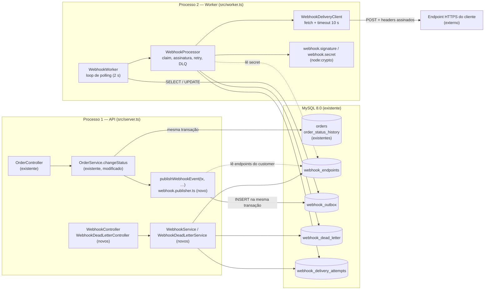
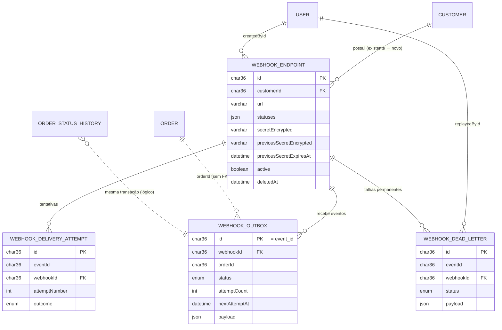
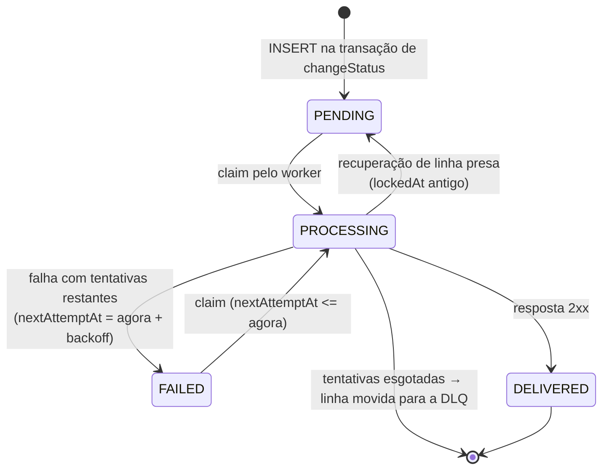
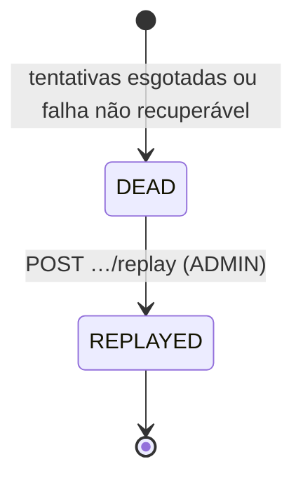
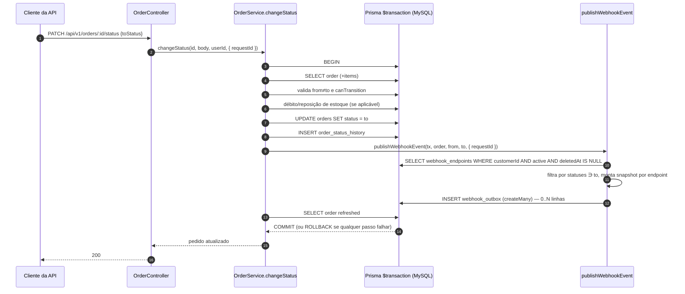
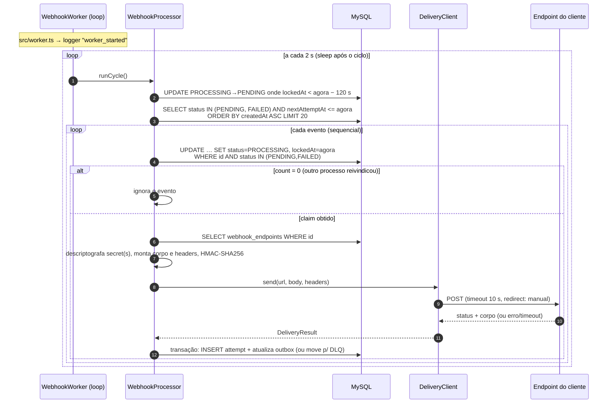
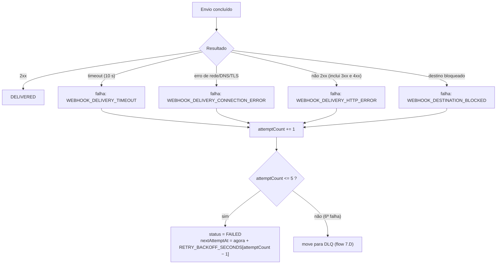
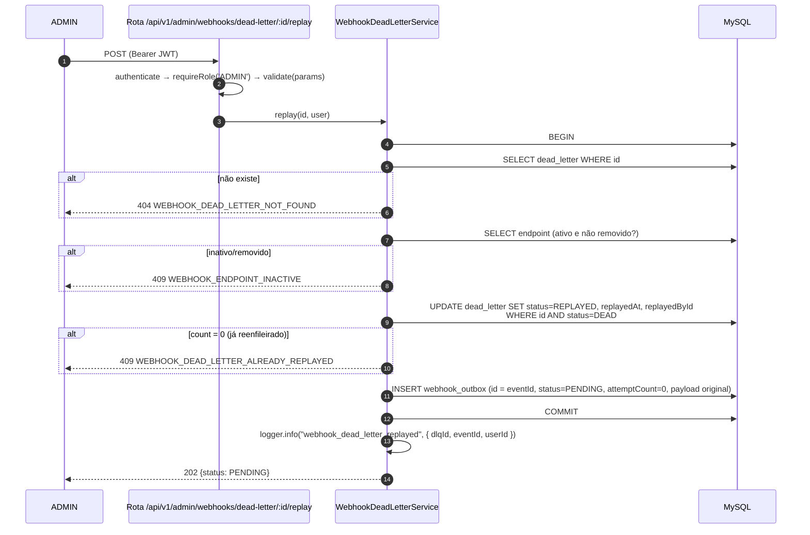
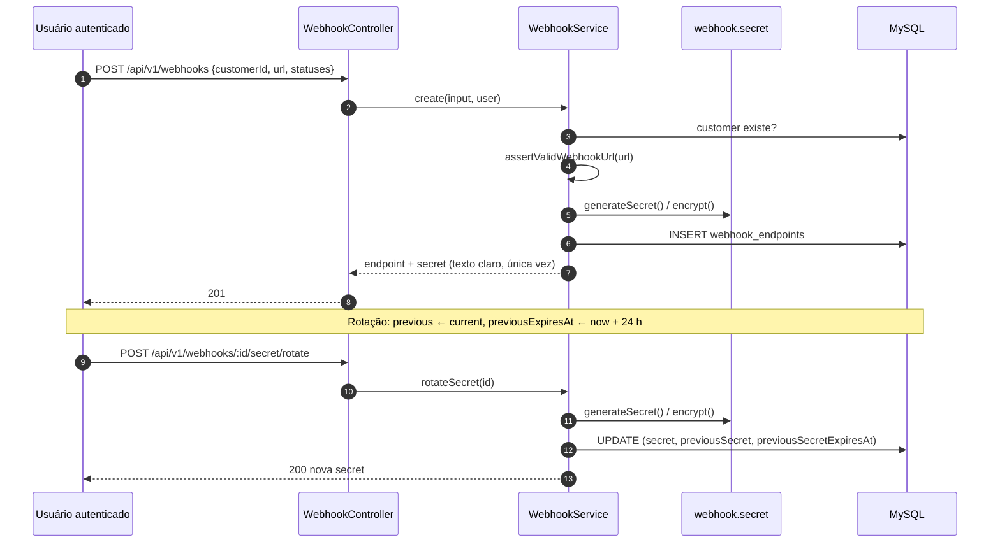
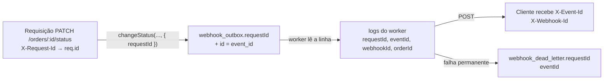

# FDD — Webhooks de saída para mudança de status de pedidos

> **Feature Design Document.** Traduz as decisões das ADRs 001–006 e a RFC em uma especificação de implementação sobre o código real do repositório `mba-ia-desafio-design-docs-com-ia`.

## Convenções deste documento

Cada ponto relevante é classificado em uma de quatro naturezas. Isso evita que uma sugestão deste FDD seja lida como decisão aprovada.

| Rótulo | Significado |
|---|---|
| **[Decidido]** | Formalizado em ADR com status Aceito. Obrigatório. Sempre acompanhado de `[ADR-00X]`. |
| **[Existente]** | Estrutura ou comportamento verificado no código do repositório (caminho e símbolo citados). |
| **[Proposta do FDD]** | Solução técnica sugerida para preencher uma lacuna de implementação. **Não foi aprovada** na reunião nem em ADR. |
| **[Pendente]** | Decisão que precisa de validação dos responsáveis. Cada item tem ID `P-xx` e está consolidado na seção 19. |

Todo caminho de arquivo, classe, função ou tipo citado como **[Existente]** foi conferido no repositório (clone em `HEAD 408b0f1`, "feat: RFC"). Itens sem esse rótulo e marcados como novos **ainda não existem** no código.

---

## 1. Metadados

| Campo | Valor |
|---|---|
| Título da feature | Webhooks de saída para mudança de status de pedidos |
| Tipo de documento | Feature Design Document (FDD) |
| Status | **Proposto para revisão** |
| Data | 02/11/2026 |
| Autoria | Felipe Manfrin (rascunho assistido por IA), a partir da RFC e das ADRs |
| Revisores sugeridos | Larissa (Tech Lead), Diego, Bruno, Sofia (segurança), Marcos (produto) |
| RFC | `RFC.md` — "Webhooks de saída para mudança de status de pedidos" (Proposto para revisão) |
| Repositório | https://github.com/Manfrin92/mba-ia-desafio-design-docs-com-ia |

**ADRs utilizadas (todas com status Aceito):**

| ADR | Título | Aspecto que governa neste FDD |
|---|---|---|
| [ADR-001] | Transactional Outbox com MySQL | Atomicidade, snapshot, filtro na inserção, UUID, `publishWebhookEvent(tx, …)` |
| [ADR-002] | Worker separado, polling e processamento sequencial | `src/worker.ts`, polling de 2 s, single worker, timeout de 10 s |
| [ADR-003] | Política de retry e DLQ | Backoff 1m/5m/30m/2h/12h, DLQ em tabela separada, replay ADMIN |
| [ADR-004] | Autenticação e assinatura HMAC-SHA256 | `X-Signature`, secret por endpoint, rotação com 24 h, headers |
| [ADR-005] | At-least-once e deduplicação por `X-Event-Id` | Semântica de entrega e deduplicação no cliente |
| [ADR-006] | Reutilização dos padrões existentes | Módulo `src/modules/webhooks`, `AppError`, Pino, Zod, prefixo `WEBHOOK_` |

**Condição de entrega [Decidido] [ADR-004]:** Sofia exige no mínimo 2 dias úteis de revisão do código de segurança (HMAC e geração de secret) antes do deploy.

**Estado do repositório [Existente]:** não há nenhuma ocorrência de `webhook`, `outbox` ou `worker` em `src/`, `tests/`, `prisma/` ou `package.json` (verificado por busca). O arquivo `docs/FDD.md` existe apenas como placeholder.

---

## 2. Contexto e motivação técnica

### 2.1 Problema

Três clientes B2B (Atlas Comercial, MaxDistribuição e Nova Cargo) consultam `GET /orders` periodicamente para descobrir mudanças de status. Querem ser notificados. Para eles, "tempo real" significa **menos de 10 segundos**. O escopo é **somente webhook de saída**. [ADR-001]

### 2.2 Como o sistema funciona hoje [Existente]

- **Mudança de status.** `OrderService.changeStatus(id, input, userId)` (`src/modules/orders/order.service.ts`, linhas 126–179) executa tudo dentro de `this.prisma.$transaction(async (tx) => …)`:
  1. lê o pedido com `tx.order.findUnique({ where: { id }, include: { items: true } })` (linha 132);
  2. valida `from === to` (`ConflictError`) e `canTransition(from, to)` (`InvalidStatusTransitionError`);
  3. debita ou repõe estoque conforme `shouldDebitStock` / `shouldReplenishStock` (`src/modules/orders/order.status.ts`);
  4. `tx.order.update` (linha 158);
  5. `tx.orderStatusHistory.create` (linhas 159–167);
  6. relê o pedido com relações e retorna.
- **Transições válidas** (`order.status.ts`): `PENDING→PAID|CANCELLED`, `PAID→PROCESSING|CANCELLED`, `PROCESSING→SHIPPED|CANCELLED`, `SHIPPED→DELIVERED`. `DELIVERED` e `CANCELLED` são terminais.
- **Criação de pedido** (`OrderService.create`, linhas 50–124) grava histórico com `fromStatus: null` → `PENDING`.
- **Exclusão** (`OrderService.delete`, linhas 181–192) só é permitida em `PENDING` ou `CANCELLED`. O histórico usa `onDelete: Cascade` em `prisma/schema.prisma`.
- **Entry point único:** `src/server.ts` (`bootstrap()` monta o app com `buildApp({ prisma })`, trata `SIGINT`/`SIGTERM` e chama `prisma.$disconnect()`).
- **Composição manual de dependências:** `buildControllers(prisma)` em `src/app.ts`; rotas montadas em `buildApiRouter` (`src/routes/index.ts`) sob o prefixo **`/api/v1`**.
- **Não existe** mecanismo de eventos, filas, webhooks, métricas ou tracing distribuído.

### 2.3 Por que a solução é necessária

O polling dos clientes em `GET /orders` deixa a integração lenta e cara para eles, e a Atlas condicionou a permanência à entrega até o fim do trimestre. [ADR-001]

### 2.4 Restrições técnicas e arquiteturais

| Restrição | Origem |
|---|---|
| Não chamar HTTP de cliente dentro da transação de `changeStatus`. Cliente lento ou fora do ar não pode travar outras mudanças nem causar rollback. | [Decidido] [ADR-001] |
| MySQL 8.0 (`docker-compose.yml`, imagem `mysql:8.0`) não tem listener nativo. Entrega por polling. | [Decidido] [ADR-002] |
| Time pequeno: sem infraestrutura nova (sem Redis, sem broker). | [Decidido] [ADR-001], [ADR-006] |
| Processo do worker separado do processo da API. | [Decidido] [ADR-002] |
| Reuso máximo: `AppError`, Pino, middleware de erro, módulos por domínio, Zod, prefixo `WEBHOOK_`. | [Decidido] [ADR-006] |
| Node `>=20` (`package.json › engines`), TypeScript estrito com `noUncheckedIndexedAccess`, ESM (`"type": "module"`, imports com sufixo `.js`). | [Existente] |
| Prisma 5.22.0 e MySQL. Colunas em camelCase, tabelas em snake_case via `@@map`, ids `@id @default(uuid()) @db.Char(36)`. | [Existente] |

### 2.5 Requisitos que influenciam a implementação

**Negócio**

- Notificar mudança de status em menos de 10 s. [ADR-001], [ADR-002]
- Cliente escolhe os status que quer receber, e o filtro é aplicado na inserção. [ADR-001]
- Cliente consulta o histórico de entregas (últimos 100). [ADR-003]
- Cliente cadastra e rotaciona webhooks pela API. [ADR-004]

**Não funcionais**

- URL do webhook obrigatoriamente `https`. Payload limitado a 64 KB, com erro se exceder. [ADR-004]
- Timeout HTTP de 10 s. [ADR-002]
- Garantia at-least-once, com deduplicação no cliente. [ADR-005]
- Revisão de segurança antes do deploy. [ADR-004]

---

## 3. Objetivos técnicos

| ID | Objetivo | Verificação (seção 17) |
|---|---|---|
| OT-01 | Gravar o evento na outbox **na mesma transação** de `changeStatus`. Falha na outbox implica rollback do status. [ADR-001] | AC-01, AC-02 |
| OT-02 | Gravar o payload já renderizado (snapshot) na inserção. [ADR-001] | AC-03 |
| OT-03 | Aplicar o filtro de status do endpoint na inserção. Sem endpoint interessado, nenhuma linha é criada. [ADR-001] | AC-04 |
| OT-04 | Executar um worker em processo separado (`src/worker.ts`, `npm run worker`) com polling de 2 s. [ADR-002] | AC-05, AC-06 |
| OT-05 | Processar sequencialmente por `createdAt`, com timeout HTTP de 10 s. [ADR-002] | AC-07 |
| OT-06 | Reenviar com backoff 1m/5m/30m/2h/12h e mover para DLQ ao esgotar. [ADR-003] | AC-08, AC-09 |
| OT-07 | Disponibilizar replay manual restrito a ADMIN, com auditoria. [ADR-003] | AC-10, AC-11 |
| OT-08 | Assinar cada envio com HMAC-SHA256 sobre o corpo, com secret única por endpoint e rotação com convivência de 24 h. [ADR-004] | AC-12, AC-13 |
| OT-09 | Enviar `X-Event-Id`, `X-Signature`, `X-Timestamp`, `X-Webhook-Id`, `Content-Type: application/json`. [ADR-004], [ADR-005] | AC-14 |
| OT-10 | Expor API de gestão (CRUD, rotação, deliveries) sob `/api/v1` com JWT existente. [ADR-004] | AC-15, AC-16 |
| OT-11 | Reutilizar os padrões existentes e não adicionar dependências npm. [ADR-006] | AC-20, AC-21 |
| OT-12 | Prover logs estruturados e correlação entre API, outbox, worker e entrega. | AC-18, AC-19 |

---

## 4. Escopo e exclusões

### 4.1 Dentro do escopo

- Webhook de saída para o evento `order.status_changed`, disparado por `OrderService.changeStatus`.
- Tabelas de endpoints, outbox, DLQ e tentativas de entrega.
- Worker de entrega (polling, assinatura, envio, retry, DLQ, recuperação de linhas presas, shutdown gracioso).
- API de gestão: criar, listar, consultar, atualizar, remover, rotacionar secret e consultar entregas.
- API administrativa: consultar DLQ **[Proposta do FDD]** e executar replay [ADR-003].
- Testes automatizados e documentação do contrato para o portal de desenvolvedores (conteúdo técnico; a redação final é de Marcos [ADR-005]).

### 4.2 Fora do escopo

Estes itens **não** devem ser implementados nesta entrega.

| Item | Origem |
|---|---|
| Webhook de entrada (clientes enviando para nós) | [ADR-001] |
| Arquivamento de linhas entregues (cerca de 30 dias) | [ADR-001] |
| Aviso por e-mail ao cliente em caso de falhas | [ADR-003] |
| Rate limiting de envio por cliente ("observar e decidir depois") | [ADR-002] |
| Múltiplos workers em paralelo | [ADR-002] |
| Dashboard visual para clientes (somente endpoints) | Reunião [09:40]; RFC |
| Endurecimento do acesso à API de gestão (qualquer role autenticada, por enquanto) | [ADR-004] |
| Deduplicação no servidor, exactly-once | [ADR-005] |
| Circuit breaker, pausa automática de endpoint, replay automático | Não discutidos |
| Emissão de evento na **criação** de pedido | Não decidido. Ver P-03 |

### 4.3 Limitações conhecidas [Decidido]

- **Ordering:** apenas por `order_id` e apenas com um único worker. Não é garantia global. [ADR-002]
- **At-least-once:** o cliente pode receber duplicatas e precisa deduplicar por `event_id`. [ADR-005]
- **Janela de retry:** cerca de 15 horas. Cliente fora do ar por mais tempo cai na DLQ e depende de replay humano. [ADR-003]
- **Sem alta disponibilidade do worker:** worker parado implica eventos acumulados sem entrega. [ADR-002]

---

## 5. Arquitetura e componentes

### 5.1 Visão geral



### 5.2 Componentes e responsabilidades

| Componente | Arquivo (novo, salvo indicação) | Responsabilidade | Depende de |
|---|---|---|---|
| **Módulo de gestão de webhooks** | `src/modules/webhooks/webhook.{controller,service,repository,routes,schemas}.ts` | CRUD de endpoints, rotação de secret, consulta de entregas. Segue o padrão de `src/modules/orders/`. [ADR-006] | `authenticate`, `validate`, `AppError`, Prisma |
| **Integração com pedidos** | `src/modules/webhooks/webhook.publisher.ts` + alteração em `src/modules/orders/order.service.ts` [Existente, modificado] | `publishWebhookEvent(tx, order, fromStatus, toStatus, ctx?)`: filtra endpoints, monta snapshot e insere linhas na outbox usando o `tx` recebido. [ADR-001] | `Prisma.TransactionClient` |
| **Persistência da outbox** | modelo `WebhookOutbox` em `prisma/schema.prisma` + migration | Fila durável de eventos a entregar. | MySQL |
| **Worker independente** | `src/worker.ts` (entry point) e `src/modules/webhooks/webhook.worker.ts` (ciclo de vida do loop) | Inicializa o processo, executa o polling a cada 2 s, trata sinais e encerra de forma graciosa. [ADR-002] | `prisma` de `src/config/database.ts`, `logger` |
| **Processador de eventos** | `src/modules/webhooks/webhook.processor.ts` | Seleciona eventos elegíveis, reivindica (claim), orquestra envio, registra tentativa, aplica retry/DLQ, recupera linhas presas. | Worker, cliente HTTP, assinatura, repository |
| **Cliente HTTP de entrega** | `src/modules/webhooks/webhook.delivery-client.ts` | `POST` com timeout de 10 s, sem seguir redirects, classificação do resultado, truncamento do corpo de resposta. Recebe `fetchImpl` injetável para testes. Usa o `fetch` global do Node 20. | `fetch`, `AbortSignal.timeout` |
| **Secrets e assinatura** | `src/modules/webhooks/webhook.secret.ts`, `webhook.signature.ts` | Geração de secret, criptografia em repouso, `signBody`, montagem de `X-Signature` com convivência de secrets. [ADR-004] | `node:crypto` |
| **Persistência da DLQ** | modelo `WebhookDeadLetter` | Evidência de falhas permanentes e origem do replay. [ADR-003] | MySQL |
| **Replay administrativo** | `webhook.dlq.service.ts`, `webhook.dlq.controller.ts` | Consulta da DLQ **[Proposta do FDD]** e replay com `requireRole('ADMIN')`. [ADR-003] | `requireRole`, repository |
| **Erros do módulo** | `src/modules/webhooks/webhook.errors.ts` | Subclasses de `AppError` com códigos `WEBHOOK_*`. [ADR-006] | `AppError` |
| **Constantes** | `src/modules/webhooks/webhook.constants.ts` | Backoff, nomes de headers, tipo de evento, limites. | — |

### 5.3 Interações e dependências existentes

- A API e o worker **não se comunicam diretamente**. O único canal é o MySQL (tabela `webhook_outbox`). Isso satisfaz a separação de processos. [ADR-002]
- O `OrderService` passa a importar `publishWebhookEvent` do módulo de webhooks. O acoplamento é de uma função, sem injeção de repository. [ADR-001] [ADR-006]
- Cada processo tem seu `PrismaClient`: `src/config/database.ts` instancia `prisma` na importação, então `src/worker.ts` obtém seu próprio cliente ao importar o mesmo módulo. [Existente] [ADR-002]
- O worker não passa pelo pipeline do Express. Por isso `errorMiddleware` **não** cobre erros do worker, que terão captura e log próprios (seção 10). [ADR-006, "Limites e divergências"]

---

## 6. Modelo de dados e persistência

### 6.1 Convenções [Existente] aplicadas às novas tabelas

- `id`: `String @id @default(uuid()) @db.Char(36)`. [ADR-001]
- Colunas em camelCase, tabelas em snake_case via `@@map` (ex.: `orders`, `order_status_history`). **[Pendente P-18]** A transcrição citava `created_at`. O FDD adota camelCase para ser coerente com o schema atual.
- `createdAt DateTime @default(now())` e `updatedAt DateTime @updatedAt`. O DDL gerado usa `DATETIME(3)` (conferido em `prisma/migrations/20260519182739_init/migration.sql`).
- Enums nativos do MySQL via `enum` do Prisma. Reaproveita o enum existente `OrderStatus`.

### 6.2 Estruturas existentes vs. novas

| Estrutura | Situação | Observação |
|---|---|---|
| `users`, `customers`, `orders`, `order_items`, `order_status_history`, `order_number_sequence`, `products` | **[Existente]** | Não são alteradas. |
| Enum `OrderStatus`, `UserRole` | **[Existente]** | Reutilizados. |
| `webhook_endpoints` | **Nova** | Configuração por endpoint. |
| `webhook_outbox` | **Nova** [ADR-001] | Nome indicativo na reunião ("tipo `webhook_outbox`"). |
| `webhook_dead_letter` | **Nova** [ADR-003] | Nome citado na reunião. |
| `webhook_delivery_attempts` | **Nova — [Proposta do FDD]** | Necessária para `GET /webhooks/:id/deliveries`. Local não definido nas ADRs (P-19). |
| Enums `WebhookOutboxStatus`, `WebhookDeadLetterStatus`, `WebhookDeliveryOutcome` | **Novos** | Estados da outbox vêm de [ADR-001]. |

### 6.3 Diagrama de entidades



**Cardinalidade proposta [Proposta do FDD] (P-04):**

| Relação | Cardinalidade |
|---|---|
| Customer → WebhookEndpoint | 1 : N |
| WebhookEndpoint → WebhookOutbox | 1 : N |
| Mudança de status → WebhookOutbox | 1 : 0..N (**uma linha por endpoint interessado**) |
| WebhookOutbox → tentativas | 1 : N (por `eventId`) |
| WebhookEndpoint → WebhookDeadLetter | 1 : N |

**Justificativa:** o filtro é por endpoint e acontece na inserção [ADR-001]. O `X-Webhook-Id` identifica qual cadastro recebeu o envio [ADR-004]. Retry, estado e DLQ são independentes por destino, então fan-out na inserção é o modelo mais simples e consistente. O `id` da linha é o `event_id` (único por linha). Isso resolve "o `event_id` é o mesmo UUID da linha?" com **sim**. Consequência: a mesma mudança de status que atinge dois endpoints gera dois `event_id` distintos. A deduplicação do cliente continua correta, porque ela é por endpoint. [ADR-005] deixou essa questão em aberto.

### 6.4 Schema Prisma proposto

```prisma
enum WebhookOutboxStatus {
  PENDING
  PROCESSING
  FAILED
  DELIVERED
}

enum WebhookDeadLetterStatus {
  DEAD
  REPLAYED
}

enum WebhookDeliveryOutcome {
  SUCCESS
  FAILURE
}

model WebhookEndpoint {
  id                      String    @id @default(uuid()) @db.Char(36)
  customerId              String    @db.Char(36)
  url                     String    @db.VarChar(2048)
  description             String?   @db.VarChar(255)
  statuses                Json
  secretEncrypted         String    @db.VarChar(512)
  previousSecretEncrypted String?   @db.VarChar(512)
  previousSecretExpiresAt DateTime?
  active                  Boolean   @default(true)
  deletedAt               DateTime?
  createdById             String    @db.Char(36)
  createdAt               DateTime  @default(now())
  updatedAt               DateTime  @updatedAt

  customer     Customer                 @relation(fields: [customerId], references: [id])
  createdBy    User                     @relation("WebhookCreatedBy", fields: [createdById], references: [id])
  outbox       WebhookOutbox[]
  deadLetters  WebhookDeadLetter[]
  attempts     WebhookDeliveryAttempt[]

  @@index([customerId, active])
  @@index([deletedAt])
  @@map("webhook_endpoints")
}

model WebhookOutbox {
  id            String              @id @db.Char(36)   // = event_id (gerado na aplicação)
  webhookId     String              @db.Char(36)
  orderId       String              @db.Char(36)       // sem FK (P-11)
  customerId    String              @db.Char(36)       // desnormalizado, sem FK
  eventType     String              @default("order.status_changed") @db.VarChar(64)
  fromStatus    OrderStatus?
  toStatus      OrderStatus
  payload       Json
  status        WebhookOutboxStatus @default(PENDING)
  attemptCount  Int                 @default(0)
  nextAttemptAt DateTime            @default(now())
  lockedAt      DateTime?
  lastError     String?             @db.VarChar(1000)
  requestId     String?             @db.VarChar(64)
  deliveredAt   DateTime?
  createdAt     DateTime            @default(now())
  updatedAt     DateTime            @updatedAt

  webhook WebhookEndpoint @relation(fields: [webhookId], references: [id])

  @@index([status, nextAttemptAt, createdAt])
  @@index([createdAt])
  @@index([orderId])
  @@index([webhookId])
  @@map("webhook_outbox")
}

model WebhookDeadLetter {
  id              String                  @id @default(uuid()) @db.Char(36)
  eventId         String                  @db.Char(36)
  webhookId       String                  @db.Char(36)
  orderId         String                  @db.Char(36)
  customerId      String                  @db.Char(36)
  eventType       String                  @db.VarChar(64)
  fromStatus      OrderStatus?
  toStatus        OrderStatus
  payload         Json
  failureReason   String                  @db.VarChar(1000)
  lastErrorCode   String                  @db.VarChar(64)
  lastHttpStatus  Int?
  attemptCount    Int
  originalCreatedAt DateTime
  failedAt        DateTime                @default(now())
  status          WebhookDeadLetterStatus @default(DEAD)
  replayedAt      DateTime?
  replayedById    String?                 @db.Char(36)
  requestId       String?                 @db.VarChar(64)
  createdAt       DateTime                @default(now())

  webhook    WebhookEndpoint @relation(fields: [webhookId], references: [id])
  replayedBy User?           @relation("WebhookReplayedBy", fields: [replayedById], references: [id])

  @@index([status, failedAt])
  @@index([webhookId])
  @@index([eventId])
  @@map("webhook_dead_letter")
}

model WebhookDeliveryAttempt {
  id            String                 @id @default(uuid()) @db.Char(36)
  eventId       String                 @db.Char(36)
  webhookId     String                 @db.Char(36)
  attemptNumber Int
  outcome       WebhookDeliveryOutcome
  httpStatus    Int?
  durationMs    Int
  errorCode     String?                @db.VarChar(64)
  errorMessage  String?                @db.VarChar(500)
  responseBody  String?                @db.Text
  requestPayload Json
  createdAt     DateTime               @default(now())

  webhook WebhookEndpoint @relation(fields: [webhookId], references: [id])

  @@index([webhookId, createdAt])
  @@index([eventId])
  @@map("webhook_delivery_attempts")
}
```

Alterações em modelos **existentes** (somente relações inversas, sem mudança de colunas):

```prisma
model Customer { /* … */ webhooks WebhookEndpoint[] }
model User     { /* … */ webhooksCreated WebhookEndpoint[] @relation("WebhookCreatedBy")
                          webhookReplays  WebhookDeadLetter[] @relation("WebhookReplayedBy") }
```

### 6.5 Dicionário de dados

#### `webhook_endpoints` — configuração do destino

| Coluna | Tipo (Prisma → MySQL) | Obrigatório / default | Descrição | Natureza |
|---|---|---|---|---|
| `id` | `String` → `CHAR(36)` | PK, `uuid()` | `X-Webhook-Id` | [Decidido] [ADR-004], [ADR-001] |
| `customerId` | `CHAR(36)` | sim, FK `customers.id` | Dono do endpoint. Vem do body/path, não do JWT. | [Decidido] [ADR-004] |
| `url` | `VARCHAR(2048)` | sim | URL `https` de destino. | [Decidido] [ADR-004] |
| `description` | `VARCHAR(255)` | não | Rótulo livre. | [Proposta do FDD] |
| `statuses` | `JSON` | sim | Lista de `OrderStatus` desejados (array de strings, 1..5 itens, sem repetição). | [Decidido] [ADR-001]; formato [Proposta do FDD] |
| `secretEncrypted` | `VARCHAR(512)` | sim | Secret vigente, criptografada (AES-256-GCM). | Armazenamento: [Pendente P-09] |
| `previousSecretEncrypted` | `VARCHAR(512)` | não | Secret anterior durante a convivência. | [Decidido] [ADR-004] (24 h) |
| `previousSecretExpiresAt` | `DATETIME(3)` | não | Fim da convivência (`rotação + 24 h`). | [Decidido] [ADR-004] |
| `active` | `BOOLEAN` | default `true` | Endpoint recebe novos eventos. | [Decidido] [ADR-004] ("estado ativo") |
| `deletedAt` | `DATETIME(3)` | não | Remoção lógica. | [Proposta do FDD] (P-28) |
| `createdById` | `CHAR(36)` | sim, FK `users.id` | Auditoria de quem cadastrou. | [Proposta do FDD] (P-10) |
| `createdAt`, `updatedAt` | `DATETIME(3)` | default `now()` | — | [Existente] (padrão) |

Índices: `(customerId, active)` atende a consulta da publicação (`customerId = ? AND active = true`); `(deletedAt)` apoia limpeza futura.

#### `webhook_outbox` — eventos a entregar

| Coluna | Tipo | Obrigatório / default | Descrição | Natureza |
|---|---|---|---|---|
| `id` | `CHAR(36)` | PK, **gerado na aplicação** com `uuidv4()` | É o `event_id` / `X-Event-Id`. Gerado antes porque o payload o contém. | [Decidido] UUID [ADR-001], [ADR-005]; "id = event_id" [Proposta do FDD] |
| `webhookId` | `CHAR(36)` | sim, FK | Endpoint destinatário. | [Proposta do FDD] (P-04) |
| `orderId` | `CHAR(36)` | sim, **sem FK** | Pedido de origem. | [Proposta do FDD] (P-11) |
| `customerId` | `CHAR(36)` | sim, sem FK | Desnormalizado para consulta. | [Proposta do FDD] |
| `eventType` | `VARCHAR(64)` | default `order.status_changed` | — | [Decidido] [ADR-001] |
| `fromStatus` / `toStatus` | `OrderStatus` | `fromStatus` nulo permitido | Nulo só existiria se a criação emitisse evento (P-03). | [Existente] (enum) |
| `payload` | `JSON` | sim | Snapshot renderizado na inserção. | [Decidido] [ADR-001] |
| `status` | `WebhookOutboxStatus` | default `PENDING` | `PENDING`, `PROCESSING`, `FAILED`, `DELIVERED`. | [Decidido] estados [ADR-001]; semântica de `FAILED` [Pendente P-02] |
| `attemptCount` | `INT` | default 0 | Envios já concluídos. | [Proposta do FDD] (necessário para [ADR-003]) |
| `nextAttemptAt` | `DATETIME(3)` | default `now()` | Elegibilidade para o polling. | [Proposta do FDD] (necessário para [ADR-003]) |
| `lockedAt` | `DATETIME(3)` | não | Marca de claim, usada na recuperação de linhas presas. | [Proposta do FDD] (P-12) |
| `lastError` | `VARCHAR(1000)` | não | Último motivo de falha. | [Proposta do FDD] |
| `requestId` | `VARCHAR(64)` | não | Correlação com a requisição que mudou o status. | [Proposta do FDD] |
| `deliveredAt` | `DATETIME(3)` | não | — | [Proposta do FDD] |

Índices: `(status, nextAttemptAt, createdAt)` serve a consulta do polling. Os índices em `status` e `createdAt` exigidos por [ADR-001] são atendidos pelo composto (prefixo `status`) e por `(createdAt)`. `orderId` e `webhookId` apoiam consultas operacionais.

#### `webhook_dead_letter` — falhas permanentes

Preserva payload, motivo e timestamp. [ADR-003]

| Coluna | Descrição | Natureza |
|---|---|---|
| `id` | PK própria da DLQ (alvo do replay: `:id` na rota) | [Proposta do FDD] |
| `eventId` | `event_id` original; **não é único** porque um replay que falhe de novo gera nova linha | [Proposta do FDD] (P-05) |
| `payload` | Snapshot original | [Decidido] [ADR-003] |
| `failureReason`, `lastErrorCode`, `lastHttpStatus` | Motivo da falha | [Decidido] ("motivo da falha") [ADR-003]; campos [Proposta do FDD] |
| `failedAt` | Timestamp da movimentação | [Decidido] [ADR-003] |
| `attemptCount`, `originalCreatedAt` | Contexto para debug | [Proposta do FDD] |
| `status` | `DEAD` ou `REPLAYED` | [Proposta do FDD] |
| `replayedAt`, `replayedById` | Auditoria persistida do replay | [Decidido] que se registre quem [ADR-003]; persistência [Proposta do FDD] (P-16) |

#### `webhook_delivery_attempts` — histórico de entregas [Proposta do FDD] (P-19)

Uma linha por tentativa de envio. Armazena `requestPayload` (cópia do snapshot, cerca de 400 bytes) para que o histórico seja consultável **mesmo depois** de o evento sair da outbox rumo à DLQ. `responseBody` é truncado em 2 KB. `durationMs` atende "tempo de resposta". [ADR-003]

### 6.6 Estados e transições

#### Outbox [Decidido: estados; Proposta do FDD: transições e semântica]



| Estado | Significado (proposto) |
|---|---|
| `PENDING` | Nunca tentado, replayado ou recuperado de queda do worker. Elegível imediatamente. |
| `PROCESSING` | Reivindicado pelo worker, com `lockedAt` preenchido. |
| `FAILED` | **Falha transitória:** pelo menos uma tentativa falhou e há retry agendado em `nextAttemptAt`. **Não** equivale à falha permanente, que é a presença na DLQ. Resolve P-02. |
| `DELIVERED` | Entregue com 2xx. Terminal (arquivamento fora do escopo). |

#### DLQ [Proposta do FDD]



O replay cria uma **nova** linha `PENDING` na outbox (mesmo `id`/`event_id`, `attemptCount = 0`) e marca a linha da DLQ como `REPLAYED`, preservando-a para auditoria.

### 6.7 Exemplos de registros

`webhook_endpoints`

```json
{
  "id": "6f1c1f6e-3f77-4a63-b3c2-0d3b3f0b9a11",
  "customerId": "c0a8f3d2-5b1e-4f0a-9c33-1d2e3f4a5b6c",
  "url": "https://api.atlas.example.com/hooks/oms",
  "statuses": ["SHIPPED", "DELIVERED"],
  "secretEncrypted": "v1:Zm9vYmFy…:YmF6cXV4…",
  "previousSecretEncrypted": null,
  "previousSecretExpiresAt": null,
  "active": true,
  "deletedAt": null
}
```

`webhook_outbox` (após a 2ª falha)

```json
{
  "id": "2d9f6a7e-8c14-4b0e-a1d5-7e3b9c0f4a22",
  "webhookId": "6f1c1f6e-3f77-4a63-b3c2-0d3b3f0b9a11",
  "orderId": "a4b3c2d1-0e9f-4a8b-b7c6-5d4e3f2a1b00",
  "status": "FAILED",
  "attemptCount": 2,
  "nextAttemptAt": "2026-11-02T14:36:20.000Z",
  "lastError": "WEBHOOK_DELIVERY_HTTP_ERROR: HTTP 503",
  "payload": { "event_id": "2d9f6a7e-8c14-4b0e-a1d5-7e3b9c0f4a22", "event_type": "order.status_changed", "…": "…" }
}
```

---

## 7. Fluxos detalhados de execução

Constantes referenciadas (em `webhook.constants.ts`, **[Proposta do FDD]** salvo indicação):

| Constante | Valor | Natureza |
|---|---|---|
| `WEBHOOK_EVENT_TYPE` | `'order.status_changed'` | [Decidido] [ADR-001] |
| `RETRY_BACKOFF_SECONDS` | `[60, 300, 1800, 7200, 43200]` | [Decidido] [ADR-003] |
| `MAX_ATTEMPTS` | `RETRY_BACKOFF_SECONDS.length + 1` = **6 envios** | [Pendente P-01] |
| `HTTP_TIMEOUT_MS` | `10_000` | [Decidido] [ADR-002] |
| `POLL_INTERVAL_MS` | `2_000` | [Decidido] [ADR-002] |
| `MAX_PAYLOAD_BYTES` | `65_536` | [Decidido] [ADR-004] |
| `BATCH_SIZE` | `20` | [Pendente P-13] |
| `PROCESSING_STALE_MS` | `120_000` | [Pendente P-12] |
| `RESPONSE_BODY_MAX_CHARS` | `2_048` | [Proposta do FDD] |

### 7.A Criação do evento na outbox

Entrada: `PATCH /api/v1/orders/:id/status` → `OrderController.changeStatus` → `OrderService.changeStatus`. [Existente]



Passo a passo:

1. **Entrada.** O controller passa a repassar `req.id` (definido por `requestLogger`) em um quarto parâmetro opcional `context`.
2. **Transação.** Toda a lógica permanece dentro do `this.prisma.$transaction(async (tx) => …)` existente. [Decidido] [ADR-001]
3. **Atualização e histórico.** Inalterados (linhas 158–167).
4. **Publicação.** Imediatamente **após** `tx.orderStatusHistory.create` e **antes** da releitura `refreshed`, chama-se `await publishWebhookEvent(tx, order, from, to, { requestId })`. A função recebe o `tx` corrente, nunca o `prisma` global. [Decidido] [ADR-001]
5. **Filtro de status.** `publishWebhookEvent` carrega os endpoints ativos do `order.customerId` e filtra em memória os que incluem `to` em `statuses`. O filtro em memória evita depender de operadores JSON do Prisma/MySQL, e o volume por customer é pequeno. Se nenhum endpoint interessar, **nenhuma linha é criada** e a função retorna. [Decidido] [ADR-001]
6. **Snapshot.** Para cada endpoint, gera `eventId = uuidv4()` (pacote `uuid` já instalado) e monta o payload da seção 8.6. Usa o argumento `to`, **não** `order.status`, porque `order` foi lido antes do `update`. [ADR-001, "Deduzidas"]
7. **Validação de tamanho.** Se `Buffer.byteLength(JSON.stringify(payload)) > 65_536`, lança `WebhookPayloadTooLargeError`. O erro derruba a transação, em coerência com "não pode haver mudança de status sem evento". Na prática o payload tem cerca de 400 bytes. [Decidido] limite [ADR-004]; efeito de rollback [Proposta do FDD] (P-26)
8. **Inserção.** Um único `tx.webhookOutbox.createMany({ data })` com `status = PENDING`, `attemptCount = 0`, `nextAttemptAt = now`.
9. **Commit/rollback.** Qualquer exceção (inclusive falha do `INSERT` da outbox) propaga e a transação inteira sofre rollback: status, estoque, histórico e outbox. Sem exceção, o commit torna tudo visível junto. [Decidido] [ADR-001]

Esboço da função **[Proposta do FDD]** (assinatura de [ADR-001]):

```ts
// src/modules/webhooks/webhook.publisher.ts
import type { Order, OrderStatus, Prisma } from '@prisma/client';

export type PublishableOrder = Pick<
  Order,
  'id' | 'orderNumber' | 'customerId' | 'subtotalCents' | 'discountCents' | 'totalCents'
>;

export type PublishContext = { requestId?: string | undefined; now?: Date };

export async function publishWebhookEvent(
  tx: Prisma.TransactionClient,
  order: PublishableOrder,
  fromStatus: OrderStatus | null,
  toStatus: OrderStatus,
  ctx: PublishContext = {},
): Promise<{ created: number }>;
```

### 7.B Processamento pelo worker



Passo a passo:

| # | Etapa | Detalhe |
|---|---|---|
| 1 | **Inicialização** | `src/worker.ts` importa `logger` e `prisma` (cada processo cria seu `PrismaClient`), instancia repository, cliente HTTP, processor e worker, registra `SIGINT`/`SIGTERM` e inicia o loop. [Decidido] [ADR-002] |
| 2 | **Conexão com o banco** | `await prisma.$connect()` na partida. Falha de conexão na partida: `logger.fatal` e `process.exit(1)`, igual ao `bootstrap().catch` de `src/server.ts`. [Existente: padrão] |
| 3 | **Recuperação** | No início de cada ciclo, linhas `PROCESSING` com `lockedAt < agora − PROCESSING_STALE_MS` voltam para `PENDING` (seção 10). |
| 4 | **Polling** | Intervalo de 2 s **entre ciclos** (`setTimeout` encadeado, sem `setInterval`, para evitar sobreposição). Se o lote veio cheio, o próximo ciclo começa imediatamente para drenar o backlog. [Decidido] [ADR-002]; drenagem [Proposta do FDD] |
| 5 | **Seleção** | `status IN ('PENDING','FAILED') AND nextAttemptAt <= now`, `ORDER BY createdAt ASC`, `LIMIT BATCH_SIZE`. Índice `(status, nextAttemptAt, createdAt)`. [Decidido] ordem por `createdAt` e lote pequeno [ADR-002] |
| 6 | **Claim** | `updateMany({ where: { id, status: { in: [PENDING, FAILED] } }, data: { status: PROCESSING, lockedAt: now } })`. Só prossegue se `count === 1`. Protege contra processamento duplicado caso dois workers sejam iniciados por engano. [Proposta do FDD] |
| 7 | **Endpoint destinatário** | Carrega `webhook_endpoints` pelo `webhookId`. Se estiver `deletedAt != null` ou `active = false`, o evento vai para a DLQ com `lastErrorCode = WEBHOOK_ENDPOINT_INACTIVE` (preservado e reenviável após reativação). [Proposta do FDD] (P-28) |
| 8 | **Corpo** | `body = JSON.stringify(outbox.payload)`. O MySQL pode reordenar as chaves do `JSON`, e isso é irrelevante porque o HMAC é calculado sobre os bytes **efetivamente enviados**. Valida `Buffer.byteLength(body) <= 65_536`. |
| 9 | **Headers** | Seção 8.7. `X-Timestamp = new Date().toISOString()` no momento do envio. |
| 10 | **Assinatura** | `HMAC-SHA256(secret, body)`. Durante a convivência, assina também com a secret anterior (seção 11). [Decidido] algoritmo e escopo [ADR-004]; formato [Pendente P-08] |
| 11 | **Envio** | `fetch(url, { method: 'POST', headers, body, redirect: 'manual', signal: AbortSignal.timeout(10_000) })`. Antes do envio, resolve o host e recusa IPs privados/loopback (seção 11). [Decidido] timeout [ADR-002] |
| 12 | **Interpretação** | Status 2xx = sucesso. Qualquer outra coisa = falha (flow 7.C). Lê no máximo 2 KB do corpo da resposta. [Pendente P-06] |
| 13 | **Atualização de estado** | Sucesso: em uma transação insere a tentativa (`SUCCESS`), marca a outbox `DELIVERED` com `deliveredAt` e `attemptCount + 1`, e zera `lockedAt`. |

Eventos de **endpoints diferentes** compartilham a mesma fila ordenada por `createdAt`. Isso é consequência direta do processamento sequencial de [ADR-002] e causa o *head-of-line blocking* tratado na seção 18 (R-09).

### 7.C Falhas e retry



| Cenário | Identificação | Tratamento |
|---|---|---|
| **Timeout** | `AbortSignal.timeout` aborta com `TimeoutError` após 10 s | Falha `WEBHOOK_DELIVERY_TIMEOUT`, `httpStatus = null` [Decidido] [ADR-002] |
| **Erro de conexão** | `fetch` rejeita (`TypeError` com `cause`: `ECONNREFUSED`, `ENOTFOUND`, erro de certificado, reset) | `WEBHOOK_DELIVERY_CONNECTION_ERROR` com o código em `errorMessage` |
| **Resposta HTTP** | `response.status` fora de 200–299 (redirects não são seguidos) | `WEBHOOK_DELIVERY_HTTP_ERROR`, guarda `httpStatus` e 2 KB do corpo. [Pendente P-06] |
| **Contador** | Incrementado **após** cada envio concluído (sucesso ou falha) | `attemptCount` = número de envios realizados |
| **Próximo horário** | `now + RETRY_BACKOFF_SECONDS[attemptCount − 1]`, sem jitter | [Decidido] progressão [ADR-003]; jitter [Pendente P-07] |
| **Retorno à fila** | `status = FAILED`, `lockedAt = null`. O polling só seleciona a linha quando `nextAttemptAt <= now` | [Proposta do FDD] |

**Tabela de agendamento (com 6 envios, P-01):**

| Envio nº | Se falhar... | Espera até o próximo | Instante acumulado desde a 1ª falha |
|---|---|---|---|
| 1 (inicial) | retry | 1 min | 1 min |
| 2 | retry | 5 min | 6 min |
| 3 | retry | 30 min | 36 min |
| 4 | retry | 2 h | 2 h 36 min |
| 5 | retry | 12 h | 14 h 36 min |
| 6 | **DLQ** | — | — |

Os cinco intervalos somam 14 h 36 min, que corresponde ao "quase 15 horas" de [ADR-003] e exige 6 envios. Se P-01 for decidido como "5 envios no total", `MAX_ATTEMPTS` passa a 5 e o intervalo de 12 h deixa de ser usado. A constante é única, então a mudança é de uma linha.

### 7.D Dead Letter Queue

**Critério de esgotamento [Decidido] [ADR-003]:** falha após esgotar a lista de backoff (6ª falha, conforme P-01). Também vão para a DLQ, **[Proposta do FDD]**, eventos cujo endpoint está inativo/removido (`WEBHOOK_ENDPOINT_INACTIVE`) ou cujo payload excede 64 KB (`WEBHOOK_PAYLOAD_TOO_LARGE`), porque retentar não resolve.

**Transferência.** Em **uma transação**:

1. `INSERT webhook_delivery_attempts` (a tentativa final);
2. `INSERT webhook_dead_letter` com `payload`, `failureReason`, `lastErrorCode`, `lastHttpStatus`, `attemptCount`, `originalCreatedAt`, `failedAt = now`, `status = DEAD`, `requestId`;
3. `DELETE webhook_outbox WHERE id = ?`.

A DLQ guarda tudo que é necessário para debug e reprocessamento (payload original, motivo, timestamps, contador). O histórico de tentativas permanece em `webhook_delivery_attempts`, acessível pelo `eventId`.

**Consulta.** `GET /api/v1/admin/webhooks/dead-letter` (ADMIN) **[Proposta do FDD]**. A reunião só definiu o replay, mas a consulta é necessária para descobrir o `:id` a reprocessar.

**Replay manual [Decidido] [ADR-003]:**



- **Autorização:** `authenticate` + `requireRole('ADMIN')`, ambos existentes em `src/middlewares/auth.middleware.ts`. [Decidido] [ADR-003]
- **Auditoria [Decidido que se registre quem; formato é Proposta do FDD, P-16]:** persistida em `replayedById`/`replayedAt` **e** em log Pino (`webhook_dead_letter_replayed`, com `userId`, `userEmail`, `dlqId`, `eventId`, `webhookId`).
- **Semântica do replay [Proposta do FDD] (P-05):** zera o contador de tentativas (novo ciclo completo de retry), **mantém o `event_id` original** (o cliente que já processou o evento o reconhece como duplicata), a linha da DLQ **não é apagada** (fica `REPLAYED`).

### 7.E Gerenciamento dos webhooks

| Operação | Fluxo |
|---|---|
| **Criação** (`POST /webhooks`) | `authenticate` → `validate(body)` → `WebhookService.create`: (1) confirma que o `customerId` existe (`NotFoundError('Customer')`); (2) valida a URL (`https`, política de host); (3) gera a secret (`whsec_` + 32 bytes aleatórios em base64url); (4) criptografa; (5) `INSERT`. Resposta `201` com a secret **em texto claro, uma única vez**. [Decidido] geração pela plataforma e devolução na criação [ADR-004] |
| **Consulta** (`GET /webhooks`, `GET /webhooks/:id`) | Lista por `customerId` (obrigatório, **[Decidido]** "listar os webhooks de um customer" — Reunião [09:33]) com paginação do padrão `paginated(...)` de `src/shared/http/response.ts`. Nunca retorna secret. Ignora endpoints com `deletedAt` preenchido. |
| **Atualização** (`PATCH /webhooks/:id`) | Campos opcionais `url`, `statuses`, `active`, `description`. Não altera secret. `statuses` substitui a lista inteira. A mudança vale para eventos **futuros**: linhas já na outbox continuam com o payload original. [Decidido] edição via PATCH (Reunião [09:33]) |
| **Remoção** (`DELETE /webhooks/:id`) | **Remoção lógica:** `deletedAt = now`, `active = false`, retorna `204`. Eventos pendentes desse endpoint vão para a DLQ com `WEBHOOK_ENDPOINT_INACTIVE` quando o worker os alcançar. [Decidido] existência de DELETE; soft delete é [Proposta do FDD] (P-28) |
| **Status de interesse** | `statuses`: array de 1 a 5 valores únicos de `PAID`, `PROCESSING`, `SHIPPED`, `DELIVERED`, `CANCELLED`. `PENDING` é rejeitado até P-03 ser decidido. [Decidido] o filtro por status [ADR-001]; conjunto permitido [Proposta do FDD] |
| **Geração da secret** | `crypto.randomBytes(32)` → `whsec_<base64url>`. [Decidido] geração pela plataforma [ADR-004]; formato [Proposta do FDD] |
| **Rotação** (`POST /webhooks/:id/secret/rotate`) | Gera nova secret. `previousSecretEncrypted ← secretEncrypted`, `previousSecretExpiresAt ← now + 24 h`, `secretEncrypted ← nova`. Retorna a nova secret uma única vez. A antiga continua válida por 24 h e depois deixa de valer. Uma segunda rotação dentro das 24 h **descarta imediatamente** a "anterior" mais antiga (só existem duas secrets vigentes). [Decidido] rotação com grace de 24 h [ADR-004]; regra da dupla rotação [Proposta do FDD] |



---

## 8. Contratos públicos

### 8.1 Convenções comuns [Existente]

- **Prefixo:** todas as rotas ficam sob **`/api/v1`**, conforme `app.use('/api/v1', buildApiRouter(controllers))` em `src/app.ts`. A reunião citou `/admin/webhooks/...` e `/webhooks/:id/deliveries` sem prefixo. O FDD adota `/api/v1/...` por consistência com o projeto. [Pendente P-17]
- **Autenticação:** `Authorization: Bearer <JWT>`, validado por `authenticate` (`src/middlewares/auth.middleware.ts`). Falhas: `401 UNAUTHORIZED` (`"Missing or invalid Authorization header"`, `"Missing bearer token"` ou `"Invalid or expired token"`).
- **Formato de erro** (`errorMiddleware`):

```json
{ "error": { "code": "WEBHOOK_NOT_FOUND", "message": "Webhook not found", "details": {} } }
```

- **Validação:** `validate({ body | query | params })` devolve `400 VALIDATION_ERROR` com `details: [{ "path": "url", "message": "…" }]`.
- **Header opcional `X-Request-Id`:** se enviado, é reaproveitado e devolvido no response (`requestLogger`).
- **Autorização da gestão:** qualquer role autenticada (`ADMIN` ou `OPERATOR`) "por enquanto". [Decidido] [ADR-004]. O `customerId` vem do body/query, **não do JWT**. [Decidido] [ADR-004]. Ver risco R-07 e P-10.
- **Autorização do replay e da consulta da DLQ:** `requireRole('ADMIN')`. [Decidido] replay [ADR-003]; consulta [Proposta do FDD].

### 8.2 Resumo dos endpoints

| # | Método e rota | Objetivo | Roles | Natureza |
|---|---|---|---|---|
| E1 | `POST /api/v1/webhooks` | Cadastrar endpoint | qualquer autenticada | [Decidido] [ADR-004] |
| E2 | `GET /api/v1/webhooks?customerId=` | Listar endpoints de um customer | qualquer autenticada | [Decidido] (Reunião [09:33]) |
| E3 | `GET /api/v1/webhooks/:id` | Consultar um endpoint | qualquer autenticada | [Proposta do FDD] |
| E4 | `PATCH /api/v1/webhooks/:id` | Editar url, status, ativo | qualquer autenticada | [Decidido] (Reunião [09:33]) |
| E5 | `DELETE /api/v1/webhooks/:id` | Remover (lógico) | qualquer autenticada | [Decidido] existência; semântica [Proposta] |
| E6 | `POST /api/v1/webhooks/:id/secret/rotate` | Rotacionar secret | qualquer autenticada | [Decidido] [ADR-004]; caminho [Proposta] |
| E7 | `GET /api/v1/webhooks/:id/deliveries` | Histórico de entregas (últimas 100) | qualquer autenticada | [Decidido] (Reunião [09:34]) |
| E8 | `GET /api/v1/admin/webhooks/dead-letter` | Consultar DLQ | ADMIN | [Proposta do FDD] (P-27) |
| E9 | `POST /api/v1/admin/webhooks/dead-letter/:id/replay` | Replay manual | ADMIN | [Decidido] [ADR-003] |

### 8.3 Representação de um webhook (comum a E1–E4, E6)

| Campo | Tipo | Descrição |
|---|---|---|
| `id` | uuid | Também enviado como `X-Webhook-Id` |
| `customerId` | uuid | — |
| `url` | string | `https`, até 2048 caracteres |
| `description` | string ou null | — |
| `statuses` | string[] | Subconjunto de `PAID`, `PROCESSING`, `SHIPPED`, `DELIVERED`, `CANCELLED` |
| `active` | boolean | — |
| `previousSecretExpiresAt` | ISO 8601 ou null | Preenchido somente enquanto a secret anterior ainda vale |
| `createdAt`, `updatedAt` | ISO 8601 | — |
| `secret` | string | **Somente** em E1 e E6, uma única vez. Nunca em consultas |

### 8.4 Endpoints de gestão

#### E1 — `POST /api/v1/webhooks`

| Informação | Descrição |
|---|---|
| Método e rota | `POST /api/v1/webhooks` |
| Objetivo | Cadastrar um endpoint de webhook para um customer e gerar sua secret |
| Autenticação | JWT Bearer |
| Autorização | Qualquer role autenticada [ADR-004] |
| Headers | `Authorization` (obrigatório), `Content-Type: application/json` (obrigatório), `X-Request-Id` (opcional) |
| Path/query params | — |
| Body (validação Zod) | `customerId` uuid (obrigatório); `url` string URL, máx. 2048 (obrigatório); `statuses` array de 1 a 5 itens únicos do conjunto permitido (obrigatório); `description` string máx. 255 (opcional); `active` boolean, default `true` |
| Semântica | Valida `customerId`, valida URL (`https` e política de host), gera secret, grava criptografada e devolve a secret em texto claro **uma única vez**. Não é idempotente |

Request:

```json
{
  "customerId": "c0a8f3d2-5b1e-4f0a-9c33-1d2e3f4a5b6c",
  "url": "https://api.atlas.example.com/hooks/oms",
  "statuses": ["SHIPPED", "DELIVERED"],
  "description": "Produção Atlas"
}
```

Response `201 Created`:

```json
{
  "id": "6f1c1f6e-3f77-4a63-b3c2-0d3b3f0b9a11",
  "customerId": "c0a8f3d2-5b1e-4f0a-9c33-1d2e3f4a5b6c",
  "url": "https://api.atlas.example.com/hooks/oms",
  "description": "Produção Atlas",
  "statuses": ["SHIPPED", "DELIVERED"],
  "active": true,
  "previousSecretExpiresAt": null,
  "createdAt": "2026-11-02T14:00:00.000Z",
  "updatedAt": "2026-11-02T14:00:00.000Z",
  "secret": "whsec_Qm9vdGhlbnRpY2F0aW9uU2VjcmV0RXhhbXBsZTAxMjM0NTY"
}
```

| Status | Condição | Código de erro |
|---|---|---|
| 201 | Criado | — |
| 400 | Body inválido (campo ausente, `statuses` vazio, status fora do conjunto, `url` malformada) | `VALIDATION_ERROR` |
| 400 | URL não `https` ou host bloqueado (loopback, rede privada, link-local) | `WEBHOOK_INVALID_URL` |
| 401 | JWT ausente, inválido ou expirado | `UNAUTHORIZED` |
| 404 | `customerId` inexistente | `NOT_FOUND` (`"Customer not found"`, classe `NotFoundError` existente) |

#### E2 — `GET /api/v1/webhooks?customerId=…`

| Informação | Descrição |
|---|---|
| Método e rota | `GET /api/v1/webhooks` |
| Objetivo | Listar os endpoints de um customer (sem secrets) |
| Autenticação / Autorização | JWT Bearer / qualquer role autenticada |
| Headers | `Authorization` |
| Query params | `customerId` uuid (**obrigatório**); `page` int ≥ 1, default 1; `pageSize` int 1–100, default 20 (mesmo padrão de `listOrdersQuerySchema`); `active` boolean (opcional) |
| Semântica | Exclui endpoints removidos logicamente. Ordena por `createdAt` decrescente |

Response `200 OK`:

```json
{
  "data": [
    {
      "id": "6f1c1f6e-3f77-4a63-b3c2-0d3b3f0b9a11",
      "customerId": "c0a8f3d2-5b1e-4f0a-9c33-1d2e3f4a5b6c",
      "url": "https://api.atlas.example.com/hooks/oms",
      "description": "Produção Atlas",
      "statuses": ["SHIPPED", "DELIVERED"],
      "active": true,
      "previousSecretExpiresAt": null,
      "createdAt": "2026-11-02T14:00:00.000Z",
      "updatedAt": "2026-11-02T14:00:00.000Z"
    }
  ],
  "pagination": { "page": 1, "pageSize": 20, "total": 1, "totalPages": 1 }
}
```

| Status | Condição | Código |
|---|---|---|
| 200 | Sucesso (lista possivelmente vazia) | — |
| 400 | `customerId` ausente ou não uuid; paginação inválida | `VALIDATION_ERROR` |
| 401 | Não autenticado | `UNAUTHORIZED` |

#### E3 — `GET /api/v1/webhooks/:id`

| Informação | Descrição |
|---|---|
| Método e rota | `GET /api/v1/webhooks/:id` |
| Objetivo | Consultar um endpoint |
| Autenticação / Autorização | JWT Bearer / qualquer role autenticada |
| Path params | `id` uuid |
| Semântica | Nunca retorna `secret`. Endpoint removido logicamente responde 404 |

Response `200 OK`: objeto da seção 8.3 (sem `secret`).

| Status | Condição | Código |
|---|---|---|
| 200 | Encontrado | — |
| 400 | `id` não uuid | `VALIDATION_ERROR` |
| 401 | Não autenticado | `UNAUTHORIZED` |
| 404 | Inexistente ou removido | `WEBHOOK_NOT_FOUND` |

#### E4 — `PATCH /api/v1/webhooks/:id`

| Informação | Descrição |
|---|---|
| Método e rota | `PATCH /api/v1/webhooks/:id` |
| Objetivo | Atualizar `url`, `statuses`, `active` e/ou `description` |
| Autenticação / Autorização | JWT Bearer / qualquer role autenticada |
| Headers | `Authorization`, `Content-Type: application/json` |
| Path params | `id` uuid |
| Body | Todos os campos opcionais, **ao menos um obrigatório**. Mesmas regras de E1. `customerId` e secret **não** são alteráveis |
| Semântica | Vale para eventos **futuros**. Linhas já na outbox preservam o snapshot e são entregues ao `url` vigente no momento do envio. Reativar (`active: true`) um endpoint **não** reenvia sozinho os eventos que já foram para a DLQ; para isso usa-se o replay (E9) |

Request:

```json
{ "statuses": ["PAID", "SHIPPED", "DELIVERED"], "active": true }
```

Response `200 OK`: objeto da seção 8.3 atualizado.

```json
{
  "id": "6f1c1f6e-3f77-4a63-b3c2-0d3b3f0b9a11",
  "customerId": "c0a8f3d2-5b1e-4f0a-9c33-1d2e3f4a5b6c",
  "url": "https://api.atlas.example.com/hooks/oms",
  "description": "Produção Atlas",
  "statuses": ["PAID", "SHIPPED", "DELIVERED"],
  "active": true,
  "previousSecretExpiresAt": null,
  "createdAt": "2026-11-02T14:00:00.000Z",
  "updatedAt": "2026-11-02T14:20:00.000Z"
}
```

| Status | Condição | Código |
|---|---|---|
| 200 | Atualizado | — |
| 400 | Body vazio ou inválido | `VALIDATION_ERROR` |
| 400 | Nova URL não `https` ou bloqueada | `WEBHOOK_INVALID_URL` |
| 401 | Não autenticado | `UNAUTHORIZED` |
| 404 | Inexistente ou removido | `WEBHOOK_NOT_FOUND` |

#### E5 — `DELETE /api/v1/webhooks/:id`

| Informação | Descrição |
|---|---|
| Método e rota | `DELETE /api/v1/webhooks/:id` |
| Objetivo | Remover o endpoint |
| Autenticação / Autorização | JWT Bearer / qualquer role autenticada |
| Path params | `id` uuid |
| Semântica | Remoção **lógica** (`deletedAt`, `active = false`) **[Proposta do FDD]** (P-28). Eventos já na outbox para esse endpoint serão movidos para a DLQ com `WEBHOOK_ENDPOINT_INACTIVE`. Idempotência: segundo `DELETE` retorna 404 |

Response `204 No Content` (sem corpo).

| Status | Condição | Código |
|---|---|---|
| 204 | Removido | — |
| 400 | `id` não uuid | `VALIDATION_ERROR` |
| 401 | Não autenticado | `UNAUTHORIZED` |
| 404 | Inexistente ou já removido | `WEBHOOK_NOT_FOUND` |

#### E6 — `POST /api/v1/webhooks/:id/secret/rotate`

| Informação | Descrição |
|---|---|
| Método e rota | `POST /api/v1/webhooks/:id/secret/rotate` (caminho **[Proposta do FDD]**, ADR-004 não o define) |
| Objetivo | Gerar nova secret mantendo a anterior válida por 24 h |
| Autenticação / Autorização | JWT Bearer / qualquer role autenticada |
| Headers | `Authorization` |
| Path params | `id` uuid |
| Body | Nenhum |
| Semântica | Nova secret passa a assinar os envios. Durante 24 h os envios carregam **duas** assinaturas (P-08). Após `previousSecretExpiresAt`, a antiga deixa de ser usada. A nova secret é exibida **uma única vez**. [ADR-004] |

Response `200 OK`:

```json
{
  "id": "6f1c1f6e-3f77-4a63-b3c2-0d3b3f0b9a11",
  "customerId": "c0a8f3d2-5b1e-4f0a-9c33-1d2e3f4a5b6c",
  "url": "https://api.atlas.example.com/hooks/oms",
  "description": "Produção Atlas",
  "statuses": ["SHIPPED", "DELIVERED"],
  "active": true,
  "previousSecretExpiresAt": "2026-11-03T14:30:00.000Z",
  "createdAt": "2026-11-02T14:00:00.000Z",
  "updatedAt": "2026-11-02T14:30:00.000Z",
  "secret": "whsec_TmV3U2VjcmV0RXhhbXBsZUFmdGVyUm90YXRpb24wMTI"
}
```

| Status | Condição | Código |
|---|---|---|
| 200 | Rotacionado | — |
| 400 | `id` não uuid | `VALIDATION_ERROR` |
| 401 | Não autenticado | `UNAUTHORIZED` |
| 404 | Inexistente ou removido | `WEBHOOK_NOT_FOUND` |

#### E7 — `GET /api/v1/webhooks/:id/deliveries`

| Informação | Descrição |
|---|---|
| Método e rota | `GET /api/v1/webhooks/:id/deliveries` |
| Objetivo | Listar as últimas tentativas de entrega do endpoint, com payload, resposta e tempo de resposta |
| Autenticação / Autorização | JWT Bearer / qualquer role autenticada |
| Path params | `id` uuid |
| Query params | `limit` int 1–100, default **100** (o teto de 100 vem de [ADR-003]); `outcome` `SUCCESS` ou `FAILURE` (opcional) |
| Semântica | Retorna as **últimas 100 tentativas** (uma linha por tentativa, mais recentes primeiro). "Últimos 100 webhooks" é interpretado como tentativas (P-19). Sem paginação além do limite |

Response `200 OK`:

```json
{
  "data": [
    {
      "id": "0b7f2c1d-9a43-4e55-8d21-3c4b5a697881",
      "eventId": "2d9f6a7e-8c14-4b0e-a1d5-7e3b9c0f4a22",
      "attemptNumber": 2,
      "outcome": "SUCCESS",
      "httpStatus": 200,
      "durationMs": 184,
      "errorCode": null,
      "errorMessage": null,
      "requestPayload": {
        "event_id": "2d9f6a7e-8c14-4b0e-a1d5-7e3b9c0f4a22",
        "event_type": "order.status_changed",
        "timestamp": "2026-11-02T14:03:21.482Z",
        "order_id": "a4b3c2d1-0e9f-4a8b-b7c6-5d4e3f2a1b00",
        "order_number": "ORD-000123",
        "from_status": "PROCESSING",
        "to_status": "SHIPPED",
        "customer_id": "c0a8f3d2-5b1e-4f0a-9c33-1d2e3f4a5b6c",
        "total_cents": 24500,
        "subtotal_cents": 25000,
        "discount_cents": 500
      },
      "responseBody": "{\"received\":true}",
      "createdAt": "2026-11-02T14:09:22.101Z"
    },
    {
      "id": "5a1d3e7f-2b64-4c08-9e1a-8f7d6c5b4a30",
      "eventId": "2d9f6a7e-8c14-4b0e-a1d5-7e3b9c0f4a22",
      "attemptNumber": 1,
      "outcome": "FAILURE",
      "httpStatus": 503,
      "durationMs": 912,
      "errorCode": "WEBHOOK_DELIVERY_HTTP_ERROR",
      "errorMessage": "HTTP 503",
      "requestPayload": { "event_id": "2d9f6a7e-8c14-4b0e-a1d5-7e3b9c0f4a22", "…": "…" },
      "responseBody": "Service Unavailable",
      "createdAt": "2026-11-02T14:03:23.440Z"
    }
  ],
  "limit": 100
}
```

| Status | Condição | Código |
|---|---|---|
| 200 | Sucesso | — |
| 400 | `id` não uuid, `limit` ou `outcome` inválidos | `VALIDATION_ERROR` |
| 401 | Não autenticado | `UNAUTHORIZED` |
| 404 | Endpoint inexistente ou removido | `WEBHOOK_NOT_FOUND` |

#### E8 — `GET /api/v1/admin/webhooks/dead-letter`

| Informação | Descrição |
|---|---|
| Método e rota | `GET /api/v1/admin/webhooks/dead-letter` |
| Objetivo | Consultar eventos na DLQ para diagnóstico e escolha do replay |
| Autenticação / Autorização | JWT Bearer / **ADMIN** (`requireRole('ADMIN')`) |
| Query params | `status` `DEAD` (default) ou `REPLAYED`; `webhookId` uuid (opcional); `page` ≥ 1 (default 1); `pageSize` 1–100 (default 20) |
| Semântica | Ordena por `failedAt` decrescente. **[Proposta do FDD]**: a consulta não foi especificada nas ADRs |

Response `200 OK`:

```json
{
  "data": [
    {
      "id": "9c8b7a65-4d32-4e10-8f9a-0b1c2d3e4f50",
      "eventId": "2d9f6a7e-8c14-4b0e-a1d5-7e3b9c0f4a22",
      "webhookId": "6f1c1f6e-3f77-4a63-b3c2-0d3b3f0b9a11",
      "orderId": "a4b3c2d1-0e9f-4a8b-b7c6-5d4e3f2a1b00",
      "status": "DEAD",
      "failureReason": "HTTP 503 após 6 tentativas",
      "lastErrorCode": "WEBHOOK_DELIVERY_HTTP_ERROR",
      "lastHttpStatus": 503,
      "attemptCount": 6,
      "payload": { "event_id": "2d9f6a7e-8c14-4b0e-a1d5-7e3b9c0f4a22", "event_type": "order.status_changed", "…": "…" },
      "originalCreatedAt": "2026-11-02T14:03:21.500Z",
      "failedAt": "2026-11-03T04:40:00.000Z",
      "replayedAt": null,
      "replayedById": null
    }
  ],
  "pagination": { "page": 1, "pageSize": 20, "total": 1, "totalPages": 1 }
}
```

| Status | Condição | Código |
|---|---|---|
| 200 | Sucesso | — |
| 400 | Query inválida | `VALIDATION_ERROR` |
| 401 | Não autenticado | `UNAUTHORIZED` |
| 403 | Role diferente de ADMIN | `FORBIDDEN` (`"Insufficient permissions"`) |

#### E9 — `POST /api/v1/admin/webhooks/dead-letter/:id/replay`

| Informação | Descrição |
|---|---|
| Método e rota | `POST /api/v1/admin/webhooks/dead-letter/:id/replay` |
| Objetivo | Recolocar o evento da DLQ na outbox como pendente |
| Autenticação | JWT Bearer |
| Autorização | **ADMIN** obrigatório, via `requireRole('ADMIN')` [ADR-003] |
| Headers | `Authorization` |
| Path params | `id` uuid (id da linha da DLQ) |
| Body | Nenhum |
| Semântica | Cria uma linha `PENDING` na outbox com o mesmo `event_id` e `attemptCount = 0`. Marca a DLQ como `REPLAYED` com `replayedAt`/`replayedById`. Registra log de auditoria. A entrega ocorre de forma assíncrona (`202`). [Decidido] [ADR-003]; detalhes [Proposta do FDD] (P-05) |

Response `202 Accepted`:

```json
{
  "deadLetterId": "9c8b7a65-4d32-4e10-8f9a-0b1c2d3e4f50",
  "eventId": "2d9f6a7e-8c14-4b0e-a1d5-7e3b9c0f4a22",
  "webhookId": "6f1c1f6e-3f77-4a63-b3c2-0d3b3f0b9a11",
  "outboxStatus": "PENDING",
  "replayedAt": "2026-11-03T09:15:00.000Z",
  "replayedById": "1e2d3c4b-5a69-4788-9a0b-c1d2e3f40516"
}
```

| Status | Condição | Código |
|---|---|---|
| 202 | Reenfileirado | — |
| 400 | `id` não uuid | `VALIDATION_ERROR` |
| 401 | Não autenticado | `UNAUTHORIZED` |
| 403 | Role diferente de ADMIN | `FORBIDDEN` |
| 404 | Linha inexistente | `WEBHOOK_DEAD_LETTER_NOT_FOUND` |
| 409 | Linha já reenfileirada | `WEBHOOK_DEAD_LETTER_ALREADY_REPLAYED` |
| 409 | Endpoint inativo ou removido | `WEBHOOK_ENDPOINT_INACTIVE` |

### 8.5 Contrato enviado ao cliente destinatário

Requisição `POST` emitida pelo worker para a `url` cadastrada.

### 8.6 Payload

Campos de [ADR-001] (itens `[09:43]`). `items` **não** é enviado; o cliente consulta `GET /orders/:id` se precisar de detalhes. [Decidido]

| Campo | Tipo | Descrição | Natureza |
|---|---|---|---|
| `event_id` | uuid | Identificador do evento. Igual ao header `X-Event-Id` | [Decidido] [ADR-001], [ADR-005] |
| `event_type` | string | Sempre `"order.status_changed"` | [Decidido] [ADR-001] |
| `timestamp` | ISO 8601 UTC | **Instante da mudança de status** (momento da inserção na outbox). Não é o instante do envio (esse é `X-Timestamp`). Serve para ordenar eventos no cliente | [Decidido] campo; semântica [Proposta do FDD] |
| `order_id` | uuid | — | [Decidido] [ADR-001] |
| `order_number` | string | Ex.: `ORD-000123` | [Decidido] [ADR-001] |
| `from_status` | string | Status anterior | [Decidido] [ADR-001] |
| `to_status` | string | Novo status | [Decidido] [ADR-001] |
| `customer_id` | uuid | — | [Decidido] [ADR-001] |
| `total_cents` | integer | Total do pedido | [Decidido] ("campos básicos … tipo `total_cents`") [ADR-001] |
| `subtotal_cents`, `discount_cents` | integer | Demais campos monetários do pedido | [Proposta do FDD] (P-29) |

```json
{
  "event_id": "2d9f6a7e-8c14-4b0e-a1d5-7e3b9c0f4a22",
  "event_type": "order.status_changed",
  "timestamp": "2026-11-02T14:03:21.482Z",
  "order_id": "a4b3c2d1-0e9f-4a8b-b7c6-5d4e3f2a1b00",
  "order_number": "ORD-000123",
  "from_status": "PROCESSING",
  "to_status": "SHIPPED",
  "customer_id": "c0a8f3d2-5b1e-4f0a-9c33-1d2e3f4a5b6c",
  "total_cents": 24500,
  "subtotal_cents": 25000,
  "discount_cents": 500
}
```

Dados internos (`changedById`, `reason`, `notes`, itens, estoque) **não** entram no payload. [Proposta do FDD]

### 8.7 Headers enviados

| Header | Valor | Significado | Natureza |
|---|---|---|---|
| `Content-Type` | `application/json` | Corpo em JSON UTF-8 | [Decidido] [ADR-004] |
| `X-Event-Id` | uuid | Identificador de deduplicação, igual a `event_id` | [Decidido] [ADR-005] |
| `X-Signature` | `sha256=<hex>[,sha256=<hex>]` | HMAC-SHA256 do corpo bruto | Header e algoritmo [Decidido] [ADR-004]; formato [Pendente P-08] |
| `X-Timestamp` | ISO 8601 UTC | Instante do **envio** (novo a cada tentativa). Permite ao cliente detectar replay se quiser | [Decidido] [ADR-004]; formato ISO [Proposta do FDD] |
| `X-Webhook-Id` | uuid | Id do cadastro (`webhook_endpoints.id`) | [Decidido] [ADR-004] |
| `User-Agent` | `OMS-Webhooks/1.0` | Identificação do emissor | [Proposta do FDD] |

### 8.8 Assinatura e validação pelo cliente

- **Escopo [Decidido] [ADR-004]:** HMAC-SHA256 sobre o **corpo bruto** do request (os bytes exatos recebidos, não o JSON reserializado). `X-Timestamp` **não** faz parte do conteúdo assinado (P-21).
- **Formato [Proposta do FDD] (P-08):** `X-Signature: sha256=<hex minúsculo>`. Durante os 24 h de convivência, o header carrega **duas** assinaturas separadas por vírgula, a da secret nova e a da anterior: `sha256=<hex_nova>,sha256=<hex_antiga>`. O cliente aceita se **qualquer** uma conferir com a secret que ele possui. Assim, ele migra no seu ritmo sem janela de falha.

Procedimento de validação (exemplo Node.js, para o portal de desenvolvedores):

```js
import crypto from 'node:crypto';

// rawBody: Buffer com o corpo EXATO recebido (use express.raw, não express.json)
function isValidSignature(rawBody, signatureHeader, secret) {
  const expected = crypto.createHmac('sha256', secret).update(rawBody).digest('hex');
  return signatureHeader
    .split(',')
    .map((part) => part.trim())
    .filter((part) => part.startsWith('sha256='))
    .map((part) => part.slice('sha256='.length))
    .some((candidate) => {
      const a = Buffer.from(candidate, 'utf8');
      const b = Buffer.from(expected, 'utf8');
      return a.length === b.length && crypto.timingSafeEqual(a, b);
    });
}
```

Recomendações ao cliente: comparar em tempo constante; rejeitar com `401` se a assinatura não conferir; opcionalmente rejeitar `X-Timestamp` muito antigo (por exemplo, mais de 5 minutos), lembrando que ele não é protegido pela assinatura; nunca registrar a secret em logs.

### 8.9 Identificação e deduplicação de eventos [Decidido] [ADR-005]

- Garantia **at-least-once**: o mesmo evento pode chegar mais de uma vez (timeout com processamento já feito, queda do worker entre a resposta e a marcação, retry, replay de DLQ).
- O cliente deduplica por `X-Event-Id` (igual a `event_id`). A plataforma **não** deduplica.
- **Comportamento esperado em duplicidade:** o cliente deve responder **2xx** sem reprocessar. Responder erro faz a plataforma continuar o ciclo de retry.
- **Ordem:** não há garantia global. Eventos de um mesmo pedido podem chegar fora de ordem (retry, múltiplos eventos em sequência rápida). O cliente deve ordenar por `timestamp` e ignorar eventos mais antigos que o estado que já conhece. [ADR-002], [ADR-005]
- **Janela de retenção dos `event_id` no cliente:** deve cobrir a janela de retry (cerca de 15 h) **e** um eventual replay, que pode ocorrer muito depois. **Recomendação ao portal:** reter por pelo menos 30 dias (P-24).
- Um replay mantém o `event_id` original. Uma mesma mudança de status entregue a **dois** endpoints diferentes usa `event_id` distintos (P-04).

### 8.10 Semântica de entrega e tratamento de respostas

| Resposta do cliente | Interpretação | Efeito |
|---|---|---|
| `2xx` (qualquer) | Sucesso | Evento `DELIVERED`. O corpo é ignorado (2 KB guardados para o histórico) |
| `3xx` | Falha. Redirects **não** são seguidos | Retry conforme backoff (P-06) |
| `4xx` | Falha | Retry conforme backoff (P-06) |
| `5xx` | Falha | Retry conforme backoff |
| Sem resposta em 10 s | Falha por timeout | Retry conforme backoff [ADR-002] |
| Erro de conexão/TLS/DNS | Falha | Retry conforme backoff |

O cliente deve responder em menos de 10 segundos. Processamento pesado deve ser assíncrono do lado dele: aceite, grave e responda `2xx`. [Decidido] [ADR-002]

---

## 9. Matriz de erros

### 9.1 Classes de erro [Existente] e novas

**Existentes (reutilizadas, em `src/shared/errors/`):** `AppError`, `BadRequestError(message, code, details)`, `ValidationError`, `UnauthorizedError`, `ForbiddenError`, `NotFoundError`, `ConflictError(message, code, details)`, `UnprocessableEntityError(message, code, details)`.

**Limite verificado [Existente]:** `NotFoundError` e `ValidationError` fixam os códigos `NOT_FOUND` e `VALIDATION_ERROR` e **não** aceitam código customizado. `WEBHOOK_NOT_FOUND` exige, portanto, uma nova subclasse. [ADR-006, "Limites"]

**Novas classes [Proposta do FDD]** em `src/modules/webhooks/webhook.errors.ts`. Estendem `AppError` ou as classes existentes que aceitam código (o módulo local evita tocar em `src/shared/errors/index.ts`):

| Classe | Estende | `statusCode` | `errorCode` |
|---|---|---|---|
| `WebhookNotFoundError` | `AppError` | 404 | `WEBHOOK_NOT_FOUND` |
| `WebhookInvalidUrlError` | `BadRequestError` | 400 | `WEBHOOK_INVALID_URL` |
| `WebhookDeadLetterNotFoundError` | `AppError` | 404 | `WEBHOOK_DEAD_LETTER_NOT_FOUND` |
| `WebhookDeadLetterAlreadyReplayedError` | `ConflictError` | 409 | `WEBHOOK_DEAD_LETTER_ALREADY_REPLAYED` |
| `WebhookEndpointInactiveError` | `ConflictError` | 409 | `WEBHOOK_ENDPOINT_INACTIVE` |
| `WebhookPayloadTooLargeError` | `UnprocessableEntityError` | 422 | `WEBHOOK_PAYLOAD_TOO_LARGE` |
| `WebhookSecretError` | `AppError` | 500 | `WEBHOOK_SECRET_REQUIRED` / `WEBHOOK_SECRET_DECRYPT_FAILED` |

Erros de **entrega** (timeout, conexão, HTTP) não são lançados para o chamador. Eles são classificados em `DeliveryResult` e persistidos em `lastErrorCode`/`errorCode`. O `errorMiddleware` não os vê. [ADR-006, "Limites"]

### 9.2 Matriz

| Código | Significado | Condição | Camada | Comportamento | HTTP | Retry / DLQ / rejeição |
|---|---|---|---|---|---|---|
| `VALIDATION_ERROR` (existente) | Entrada inválida | Falha de Zod em body/query/params | Middleware `validate` | Resposta 400 com `details` | 400 | Rejeição imediata |
| `UNAUTHORIZED` (existente) | Não autenticado | JWT ausente/inválido/expirado | `authenticate` | Resposta 401 | 401 | Rejeição imediata |
| `FORBIDDEN` (existente) | Sem permissão | Role ≠ ADMIN em E8/E9 | `requireRole` | Resposta 403 | 403 | Rejeição imediata |
| `NOT_FOUND` (existente) | Customer inexistente | `customerId` não encontrado em E1 | Service | Resposta 404 | 404 | Rejeição imediata |
| `WEBHOOK_NOT_FOUND` | Webhook inexistente | `id` não existe ou `deletedAt` preenchido | Service | Resposta 404 | 404 | Rejeição imediata |
| `WEBHOOK_INVALID_URL` | URL não aceita | Não `https`; host loopback/privado/link-local; credenciais embutidas na URL | Service (`assertValidWebhookUrl`) | Resposta 400 | 400 | Rejeição imediata |
| `WEBHOOK_SECRET_REQUIRED` | Secret ausente | Endpoint sem material de secret utilizável (invariante violada) | Worker/Service | Loga `error`; evento vai para DLQ | 500 (HTTP) / n.a. (worker) | DLQ (não adianta retentar) |
| `WEBHOOK_SECRET_DECRYPT_FAILED` | Falha ao descriptografar | Chave `WEBHOOK_SECRET_ENCRYPTION_KEY` incorreta ou dado corrompido | Worker | Loga `error` (sem a secret); evento vai para DLQ | n.a. | DLQ |
| `WEBHOOK_PAYLOAD_TOO_LARGE` | Payload > 64 KB | Snapshot excede 65 536 bytes | Publisher (inserção) e Worker (defensivo) | Inserção: rollback do `changeStatus`. Worker: DLQ | 422 (inserção) | Rollback / DLQ |
| `WEBHOOK_DELIVERY_TIMEOUT` | Sem resposta em 10 s | `AbortSignal.timeout` | Worker (cliente HTTP) | Registra tentativa `FAILURE` | n.a. | Retry; DLQ ao esgotar |
| `WEBHOOK_DELIVERY_CONNECTION_ERROR` | Falha de rede | DNS, recusa de conexão, TLS, reset | Worker | Registra tentativa `FAILURE` | n.a. | Retry; DLQ ao esgotar |
| `WEBHOOK_DELIVERY_HTTP_ERROR` | Resposta não 2xx | Qualquer status fora de 200–299, inclusive 3xx | Worker | Registra tentativa `FAILURE` com `httpStatus` | n.a. | Retry; DLQ ao esgotar (P-06) |
| `WEBHOOK_DESTINATION_BLOCKED` | Destino proibido no envio | Host resolve para IP privado/loopback/link-local | Worker (pré-envio) | Registra tentativa `FAILURE` sem enviar | n.a. | Retry; DLQ ao esgotar |
| `WEBHOOK_ENDPOINT_INACTIVE` | Endpoint inativo/removido | Worker encontra `active = false` ou `deletedAt`; replay para endpoint inativo | Worker / Service | Worker: DLQ imediata. Replay: 409 | 409 (replay) | DLQ (worker) / rejeição (replay) |
| `WEBHOOK_DEAD_LETTER_NOT_FOUND` | DLQ inexistente | `:id` não existe | Service | Resposta 404 | 404 | Rejeição imediata |
| `WEBHOOK_DEAD_LETTER_ALREADY_REPLAYED` | Replay duplicado | Linha da DLQ já `REPLAYED` | Service | Resposta 409 | 409 | Rejeição imediata |
| `INTERNAL_SERVER_ERROR` (existente) | Falha de persistência na API | Prisma falha ao inserir na outbox ou em CRUD | `errorMiddleware` | Em `changeStatus`: rollback total e 500 | 500 | Rollback (nenhum evento, nenhuma mudança) |
| `CONFLICT` (existente, via P2002) | Violação de unicidade | Colisão de `id` na reinserção do replay | `errorMiddleware` | 409 | 409 | Rejeição imediata |

**Erros do `changeStatus` que passam a coexistir:** `INSUFFICIENT_STOCK`, `INVALID_STATUS_TRANSITION`, `NOT_FOUND` e `CONFLICT` continuam inalterados. Nenhum deles é mascarado pela publicação, porque `publishWebhookEvent` só roda depois das validações.

**Observação sobre `P2003` [Existente, lacuna verificada]:** `errorMiddleware` trata apenas `P2002` e `P2025` do Prisma. Uma violação de chave estrangeira (`P2003`) vira `500`. Isso afeta o fluxo de exclusão de customer com webhooks cadastrados (R-A7, P-23).

---

## 10. Estratégias de resiliência

| Tema | Estratégia | Natureza |
|---|---|---|
| **Timeout HTTP** | 10 s por tentativa, via `AbortSignal.timeout(10_000)`. Também cobre a leitura do corpo da resposta. Timeout = falha com retry. | [Decidido] [ADR-002], [ADR-003] |
| **Retry** | Toda falha de entrega reagenda a mesma linha (`status = FAILED`, `nextAttemptAt` no futuro). | [Decidido] [ADR-003] |
| **Backoff exponencial** | 1 min, 5 min, 30 min, 2 h, 12 h (constante `RETRY_BACKOFF_SECONDS`). Sem jitter. | [Decidido] progressão [ADR-003]; jitter [Pendente P-07] |
| **Limite de tentativas** | `MAX_ATTEMPTS = RETRY_BACKOFF_SECONDS.length + 1` (6 envios). Esgotado, DLQ. | [Decidido] teto de 5 [ADR-003]; contagem [Pendente P-01] |
| **Falhas transitórias × permanentes** | **Transitórias** (seguem o backoff): timeout, erro de conexão, qualquer resposta não 2xx. **Permanentes** (DLQ imediata, pois retentar não resolve): endpoint inativo/removido, secret ilegível, payload > 64 KB. Nenhum código 4xx é tratado como permanente por padrão. | Permanência por esgotamento [Decidido] [ADR-003]; classificação [Proposta do FDD] (P-06) |
| **Recuperação após queda do worker** | Linhas `PROCESSING` com `lockedAt < agora − 120 s` voltam para `PENDING` no início de cada ciclo (e na partida). `attemptCount` não é incrementado, pois a tentativa não foi concluída. A tentativa pode ter chegado ao cliente (duplicata), o que é compatível com at-least-once. O limiar (120 s) supera com folga o timeout de 10 s. | [Proposta do FDD] (P-12). Lacuna apontada em [ADR-002] |
| **Banco indisponível** | O ciclo captura a exceção, loga `webhook_worker_cycle_failed` (nível `error`) e repete com espera crescente (2 s, 4 s, … teto de 30 s), voltando a 2 s após um ciclo bem-sucedido. O processo **não** encerra. O Prisma reabre conexões sozinho. Na API, a falha do banco já derruba `changeStatus` por inteiro (rollback implícito). | [Proposta do FDD] |
| **Shutdown gracioso** | `SIGINT`/`SIGTERM` ligam a flag `stopping`: não inicia novo evento, aguarda o evento em curso (no máximo 10 s pelo timeout), executa `prisma.$disconnect()` e sai com código 0. Um temporizador de segurança de 15 s força `process.exit(1)`. Baseado no padrão de `src/server.ts`. Evento interrompido no meio fica `PROCESSING` e é recuperado pela regra acima. | [Proposta do FDD]. Lacuna apontada em [ADR-002] |
| **Prevenção de processamento duplicado** | Claim atômico por `updateMany` condicionado ao status. Só processa se `count === 1`. Garante que dois workers iniciados por engano não enviem o mesmo evento em paralelo. Não substitui at-least-once. | [Proposta do FDD] |
| **Ordenação** | `ORDER BY createdAt ASC`, single worker, processamento sequencial. Garante ordem por pedido **apenas** sem falhas. Um evento em `FAILED` aguardando retry **pode ser ultrapassado** por evento posterior do mesmo pedido. | [Decidido] limitação [ADR-002]; ultrapassagem é risco inferido (R-02, P-15) |
| **Indisponibilidade prolongada de um endpoint** | Os eventos desse endpoint percorrem o backoff (cerca de 14 h 36 min) e caem na DLQ. Enquanto isso, o endpoint continua consumindo ciclos do worker a cada tentativa (até 10 s cada) e atrasa os demais (R-09). Não há circuit breaker nem pausa automática. | [Decidido] retry e DLQ [ADR-003]; ausência de circuit breaker é lacuna (P-14) |
| **Idempotência do lado do envio** | Não há. Duplicatas são resolvidas pelo cliente com `X-Event-Id`. | [Decidido] [ADR-005] |

**Garantia de ponta a ponta:** se a transação de `changeStatus` fez commit, o evento existe na outbox e será entregue **ao menos uma vez dentro da política de retry**. Passado esse limite, ele aguarda replay humano na DLQ. [ADR-001], [ADR-003], [ADR-005]

**Métrica de latência esperada:** com endpoint saudável e outbox sem backlog, a entrega ocorre em até `POLL_INTERVAL_MS (2 s) + tempo de processamento`, compatível com a meta de menos de 10 s. Essa meta **não** é garantida durante head-of-line blocking (R-09). [ADR-002]

---

## 11. Segurança

### 11.1 Autenticação e autorização da API de gestão

| Operação | Mecanismo | Natureza |
|---|---|---|
| E1–E7 | `authenticate` (JWT) e **sem** `requireRole`: qualquer role autenticada | [Decidido] [ADR-004] |
| E8, E9 | `authenticate` + `requireRole('ADMIN')` | Replay: [Decidido] [ADR-003]; E8: [Proposta do FDD] |
| Origem do `customerId` | Body (E1) ou query (E2). **Não** vem do JWT | [Decidido] [ADR-004] |

**Lacuna de segurança [Existente] vs. reunião (R-07, P-10):** na reunião, Marcos falou em "usuários que representam o cliente" [09:32]. No código, o modelo `User` (`prisma/schema.prisma`) não tem relação com `Customer`, e `AuthUser` tem apenas `id`, `email` e `role`. Portanto, com o CRUD aberto a qualquer role, **qualquer usuário autenticado pode cadastrar, alterar, rotacionar ou apagar webhooks de qualquer customer**, e ler o histórico de entregas (que contém payloads de pedidos) de qualquer endpoint. O FDD **não** inventa um controle de escopo, porque a decisão aceita é "qualquer role autenticada, por enquanto". Mitigações dentro da decisão: `createdById` auditável e logs de cada operação (`webhook_endpoint_created|updated|deleted|secret_rotated`). A decisão de endurecer (por exemplo, restringir a ADMIN ou vincular `User` a `Customer`) é **[Pendente P-10]** e deve ser tomada **antes de produção**.

### 11.2 Geração e armazenamento das secrets

| Aspecto | Definição | Natureza |
|---|---|---|
| Geração | Pela plataforma. `crypto.randomBytes(32)` → `whsec_` + base64url (cerca de 49 caracteres, 256 bits de entropia) | [Decidido] geração [ADR-004]; formato [Proposta do FDD] |
| Unicidade | Uma secret **por endpoint**, nunca global | [Decidido] [ADR-004] |
| Exibição | Em texto claro **somente** nas respostas de E1 e E6. Não existe endpoint de leitura | [Decidido] devolução na criação [ADR-004]; "nunca mais exibida" [Proposta do FDD] (P-09) |
| Armazenamento | Precisa ser **recuperável** pelo worker para assinar, então não pode ser hash. Proposta: criptografia em repouso com **AES-256-GCM** (`node:crypto`), chave de 32 bytes em `WEBHOOK_SECRET_ENCRYPTION_KEY` (base64). Formato: `v1:<iv_b64>:<ciphertext+tag_b64>` (o prefixo `v1` permite rotacionar a chave de criptografia no futuro). Alternativa mais simples: texto claro na coluna | [Pendente P-09] (ADR-004 deixa em aberto). A revisão de Sofia deve decidir |
| Acesso | Somente `webhook.secret.ts` descriptografa, e somente o worker (e a rotação) a utilizam. Nunca é retornada por E2–E4, E7, E8 | [Proposta do FDD] |

### 11.3 Assinatura HMAC-SHA256

- `signBody(secret, body) = hmac('sha256', secret).update(body).digest('hex')`, com `node:crypto` (nenhuma dependência nova). [Decidido] algoritmo e escopo [ADR-004]
- A assinatura cobre os **bytes enviados**. O corpo é o mesmo `string` passado a `fetch`. [Proposta do FDD]
- `X-Timestamp` **não** é assinado (limitação herdada da decisão, R-05). Se o produto quiser proteção forte contra replay, será necessário **alterar a ADR-004** (por exemplo, assinar `timestamp + "." + body`). Este FDD **não** altera a decisão. [Pendente P-21]

### 11.4 Rotação e convivência de secrets

- E6 gera nova secret. A anterior permanece válida por **24 h**. [Decidido] [ADR-004]
- Durante a convivência, o envio carrega `X-Signature: sha256=<nova>,sha256=<antiga>` (dupla assinatura). [Proposta do FDD] (P-08)
- Após `previousSecretExpiresAt`, o worker ignora a secret anterior (verificação por comparação de datas no envio, **sem job de limpeza**). A coluna é zerada na próxima rotação ou atualização.
- Rotação dupla dentro das 24 h: a "anterior" mais antiga é descartada de imediato. [Proposta do FDD]

### 11.5 Proteção de dados sensíveis em logs

**Estado atual [Existente]:** `redactPaths` em `src/shared/logger/index.ts` cobre `req.headers.authorization`, `req.headers.cookie`, `*.password`, `*.passwordHash`, `*.token`, `*.accessToken`. **Não** cobre secret nem assinatura. Dado o histórico de vazamento em log ("já teve cliente que vazou secret em log", Reunião [09:22]), a proposta estende a lista (seção 12.5):

`secret`, `*.secret`, `*.secretEncrypted`, `*.previousSecretEncrypted`, `signature`, `*.signature`, `*.headers["x-signature"]`.

Regras complementares **[Proposta do FDD]**:

- A redação é a última barreira. O código **nunca** passa objetos de endpoint inteiros ao logger. Loga apenas ids.
- Corpos de resposta de clientes **não** vão para logs, apenas `responseBytes`. O corpo truncado (2 KB) fica na tabela de tentativas.
- Payloads de pedido não são logados em nível `info`.

### 11.6 Validação de URLs e riscos de destinos externos

| Controle | Detalhe | Natureza |
|---|---|---|
| Protocolo | `https` obrigatório. `http` recusado com erro de validação. | [Decidido] [ADR-004] (a reunião o classifica como validação Zod) |
| Onde validar | `assertValidWebhookUrl` no service, que devolve `WEBHOOK_INVALID_URL` (400). O middleware `validate` só produz `VALIDATION_ERROR`, então o código de [ADR-006] exige validação no service. O schema Zod valida formato (`z.string().url().max(2048)`). | [Proposta do FDD] (P-25) |
| Credenciais na URL | `user:pass@host` recusado | [Proposta do FDD] |
| SSRF no cadastro | Recusa `localhost`, sufixos `.local`/`.internal`, IPs literais loopback, privados (10/8, 172.16/12, 192.168/16), link-local (169.254/16), `::1`, `fc00::/7`, `fe80::/10` | [Proposta do FDD] (P-25) |
| SSRF no envio | O worker resolve o host com `dns.lookup(all)` e recusa se algum endereço for proibido (`WEBHOOK_DESTINATION_BLOCKED`). Cobre DNS que passa a apontar para rede interna após o cadastro. Risco residual de *rebinding* entre a checagem e o `fetch` (R-A4) | [Proposta do FDD] |
| Escape para dev/test | `WEBHOOK_ALLOW_PRIVATE_HOSTS=true` desliga as checagens de IP | [Proposta do FDD] |
| Redirects | **Não** seguidos (`redirect: 'manual'`), para evitar desvio para hosts internos | [Proposta do FDD] |
| Tamanho do payload | Máximo 65 536 bytes. Excedeu: erro, **não** trunca. | [Decidido] [ADR-004] |
| Tamanho da resposta lida | Máx. 2 KB do corpo (leitura em stream com cancelamento) | [Proposta do FDD] |
| Segredo no corpo da resposta | O cliente pode devolver conteúdo sensível, que fica em `responseBody`. Mitigação: truncamento e acesso restrito ao endpoint E7 (que já é aberto, ver 11.1) | R-A10 |

### 11.7 Revisão de segurança obrigatória [Decidido] [ADR-004]

Antes do deploy, Sofia revisa por pelo menos 2 dias úteis: `webhook.secret.ts`, `webhook.signature.ts`, `webhook.delivery-client.ts`, `assertValidWebhookUrl` e as redações de log. Pontos de decisão que a revisão deve fechar: P-08, P-09, P-10, P-21, P-25.

---

## 12. Integração com o sistema existente

Todos os arquivos abaixo foram confirmados no repositório. As alterações são **aditivas** e preservam o comportamento atual de pedidos, clientes, produtos, usuários e autenticação.

### 12.1 `src/modules/orders/order.service.ts` — ponto crítico

| Informação | Descrição |
|---|---|
| Caminho | `src/modules/orders/order.service.ts` |
| Responsabilidade atual | Regras de pedidos. `changeStatus` (linhas 126–179) roda em `this.prisma.$transaction(async (tx) => …)`: lê o pedido, valida transição, debita/repõe estoque, `tx.order.update`, `tx.orderStatusHistory.create`, relê e retorna. O tipo local `TxClient = Prisma.TransactionClient` (linha 24) **não é exportado** |
| Integração necessária | Publicar o evento de webhook **dentro** da transação existente, preservando atomicidade [ADR-001] |
| Alterações propostas | (1) importar `publishWebhookEvent`; (2) adicionar o quarto parâmetro opcional `context`; (3) chamar `publishWebhookEvent` após `tx.orderStatusHistory.create` (hoje linhas 159–167) e antes da releitura `refreshed` (linha 169) |
| Novos elementos | Parâmetro `context?: { requestId?: string }`; chamada à função do publisher |
| Dependências | `src/modules/webhooks/webhook.publisher.ts` |

Alteração proposta:

```ts
import { publishWebhookEvent } from '../webhooks/webhook.publisher.js';

async changeStatus(
  id: string,
  input: UpdateOrderStatusInput,
  userId: string,
  context: { requestId?: string } = {},
): Promise<OrderWithRelations> {
  return this.prisma.$transaction(async (tx) => {
    // … código existente inalterado até tx.orderStatusHistory.create(...)

    await publishWebhookEvent(tx, order, from, to, { requestId: context.requestId });

    const refreshed = await tx.order.findUnique({ /* … inalterado */ });
    return refreshed!;
  });
}
```

Comportamento esperado:

- `order` foi lido **antes** do `update` (linha 132 vs. 158), então `order.status` é o **status antigo**. O publisher usa os argumentos `from`/`to` e nunca `order.status`.
- Qualquer exceção da publicação aborta a transação inteira (rollback de estoque, pedido, histórico e outbox). [ADR-001]
- O construtor de `OrderService` (`orders`, `prisma`) **não muda**, então `buildControllers` não precisa alterar a criação do `OrderService`. É por isso que a integração é feita por função com `tx`, e não por injeção de repository. [ADR-001]
- `OrderService.create` **não** é alterado nesta entrega (P-03).
- `OrderService.delete` não é alterado. A outbox não tem FK para `orders`, então apagar um pedido `PENDING`/`CANCELLED` **não** remove nem bloqueia eventos já gravados (P-11).

### 12.2 `src/modules/orders/order.controller.ts`

| Informação | Descrição |
|---|---|
| Caminho | `src/modules/orders/order.controller.ts` |
| Responsabilidade atual | Handlers `list`, `getById`, `create`, `changeStatus`, `delete`. `changeStatus` chama `this.orders.changeStatus(req.params.id!, req.body, req.user.id)` |
| Integração necessária | Repassar o id de correlação da requisição para a outbox |
| Alterações propostas | Passar `{ requestId: req.id }` como 4º argumento. `req.id` já existe: `requestLogger` o define e `auth.middleware.ts` o declara em `Request` |
| Novos elementos | Nenhum |
| Dependências | `src/middlewares/request-logger.middleware.ts` |

```ts
const updated = await this.orders.changeStatus(
  req.params.id!, req.body, req.user.id, { requestId: req.id },
);
```

### 12.3 `prisma/schema.prisma` e migrations

| Informação | Descrição |
|---|---|
| Caminho | `prisma/schema.prisma`; `prisma/migrations/` (hoje só `20260519182739_init`) |
| Responsabilidade atual | Define os modelos, o enum `OrderStatus` e o padrão de ids/tabelas (`@@map` snake_case). Datasource MySQL com `shadowDatabaseUrl` |
| Integração necessária | Adicionar os modelos da seção 6.4 |
| Alterações propostas | Novos enums e quatro modelos. Relações inversas em `Customer` (`webhooks`) e `User` (`webhooksCreated`, `webhookReplays`). Nenhuma coluna existente muda |
| Novos elementos | `WebhookEndpoint`, `WebhookOutbox`, `WebhookDeadLetter`, `WebhookDeliveryAttempt`; enums `WebhookOutboxStatus`, `WebhookDeadLetterStatus`, `WebhookDeliveryOutcome` |
| Dependências | Migration gerada com `npm run db:migrate -- --name webhooks_outbox` (`prisma migrate dev`) |

Operações Prisma esperadas: `tx.webhookEndpoint.findMany` e `tx.webhookOutbox.createMany` (publisher); `webhookOutbox.updateMany` (claim e recuperação); `$transaction([...])` ou interativa (sucesso e DLQ); `webhookDeadLetter.updateMany` (replay).

### 12.4 `src/app.ts` e `src/routes/index.ts` — registro do módulo

| Informação | Descrição |
|---|---|
| Caminhos | `src/app.ts`; `src/routes/index.ts` |
| Responsabilidade atual | `buildControllers(prisma)` instancia repositories/services/controllers manualmente e devolve `Controllers`. `buildApp` monta `app.use('/api/v1', buildApiRouter(controllers))`, 404 e `errorMiddleware`. `buildApiRouter` faz `router.use('/auth' \| '/users' \| '/customers' \| '/products' \| '/orders', …)` |
| Integração necessária | Registrar os novos controllers e rotas sob `/api/v1` |
| Alterações propostas | Ver abaixo |
| Novos elementos | `buildWebhookRouter`, `buildWebhookAdminRouter`; chaves `webhooks` e `webhookAdmin` em `Controllers` |
| Dependências | `src/modules/webhooks/*` |

`src/app.ts` (dentro de `buildControllers`):

```ts
const webhookRepository = new WebhookRepository(prisma);
const webhookService = new WebhookService(webhookRepository, prisma);
const webhookController = new WebhookController(webhookService);
const webhookDeadLetterService = new WebhookDeadLetterService(webhookRepository, prisma);
const webhookDeadLetterController = new WebhookDeadLetterController(webhookDeadLetterService);

return { /* … existentes */, webhooks: webhookController, webhookAdmin: webhookDeadLetterController };
```

`src/routes/index.ts`:

```ts
export type Controllers = { /* … existentes */
  webhooks: WebhookController;
  webhookAdmin: WebhookDeadLetterController;
};

router.use('/webhooks', buildWebhookRouter(controllers.webhooks));
router.use('/admin/webhooks', buildWebhookAdminRouter(controllers.webhookAdmin));
```

Rotas: `buildWebhookRouter` aplica `router.use(authenticate)` (como `buildOrderRouter` e `buildCustomerRouter`); `buildWebhookAdminRouter` aplica `router.use(authenticate, requireRole('ADMIN'))`. O JSON parser global (`express.json({ limit: '1mb' })`) já cobre os bodies de gestão.

### 12.5 Tratamento de erros: `src/shared/errors/*` e `src/middlewares/error.middleware.ts`

| Informação | Descrição |
|---|---|
| Caminhos | `src/shared/errors/app-error.ts`, `http-errors.ts`, `index.ts`; `src/middlewares/error.middleware.ts` |
| Responsabilidade atual | `AppError(message, statusCode, errorCode, details)`. `errorMiddleware` converte `AppError`, `ZodError`, Prisma `P2002` (409 `CONFLICT`) e `P2025` (404 `NOT_FOUND`) e responde 500 genérico para o resto, logando com `requestId` |
| Integração necessária | Erros HTTP do módulo reaproveitam o pipeline sem mudança. O worker precisa de tratamento próprio |
| Alterações propostas | **Nenhuma** nos arquivos acima. As novas classes ficam em `src/modules/webhooks/webhook.errors.ts` (seção 9.1). Opcional, fora do escopo: mapear `P2003` no middleware (P-23) |
| Novos elementos | `WebhookNotFoundError`, `WebhookInvalidUrlError`, `WebhookDeadLetterNotFoundError`, `WebhookDeadLetterAlreadyReplayedError`, `WebhookEndpointInactiveError`, `WebhookPayloadTooLargeError`, `WebhookSecretError` |
| Dependências | `AppError`, `BadRequestError`, `ConflictError`, `UnprocessableEntityError` |

No worker, o ciclo é envolvido em `try/catch`. Erros inesperados são logados com `logger.error({ err, eventId }, 'webhook_event_processing_failed')`, e o evento volta para o fluxo de falha (retry) em vez de derrubar o processo.

### 12.6 Autenticação: `src/middlewares/auth.middleware.ts`

| Informação | Descrição |
|---|---|
| Caminho | `src/middlewares/auth.middleware.ts` |
| Responsabilidade atual | `authenticate` valida o JWT Bearer e preenche `req.user` (`id`, `email`, `role`). `requireRole(...roles)` devolve 403 se a role não estiver na lista. Já usado como `requireRole('ADMIN')` em `src/modules/users/user.routes.ts` |
| Integração necessária | Proteger E1–E9 sem alterar o middleware |
| Alterações propostas | Nenhuma |
| Novos elementos | Uso: `authenticate` (E1–E7) e `authenticate + requireRole('ADMIN')` (E8, E9). O service do replay recebe `req.user` (`id`, `email`) para auditoria |
| Dependências | `req.user.id` alimenta `createdById` e `replayedById` |

### 12.7 Logger: `src/shared/logger/index.ts`

| Informação | Descrição |
|---|---|
| Caminho | `src/shared/logger/index.ts` |
| Responsabilidade atual | `createLogger()` configura Pino com `redactPaths` fixo, `base: { service: 'order-management-api', env }`. Exporta `logger` |
| Integração necessária | Rótulo distinto para o worker e redação de secrets/assinaturas |
| Alterações propostas | (1) `createLogger(service = 'order-management-api')` usando o parâmetro em `base.service`; (2) acrescentar caminhos de redação (seção 11.5); (3) `export const logger = createLogger()` permanece |
| Novos elementos | Parâmetro `service`; `redactPaths` ampliado. O worker usa `createLogger('order-management-worker')` |
| Dependências | `src/config/env.ts` (`LOG_LEVEL`, `NODE_ENV`) |

### 12.8 Configuração: `src/config/env.ts`, `src/config/database.ts`, `src/server.ts`

| Informação | Descrição |
|---|---|
| Caminhos | `src/config/env.ts`; `src/config/database.ts`; `src/server.ts` |
| Responsabilidade atual | `env.ts` valida `process.env` com Zod na importação e encerra se inválido (exige `DATABASE_URL` e `JWT_SECRET` com 16+ caracteres). `database.ts` exporta `createPrismaClient()` e o singleton `prisma`. `server.ts` é o único entry point |
| Integração necessária | O worker compartilha `.env`, logger e Prisma. Precisa das novas variáveis |
| Alterações propostas | `env.ts`: adicionar as variáveis da seção 15.4. `database.ts`: **sem mudança** (o worker é outro processo, então a importação já cria um `PrismaClient` próprio) [ADR-002]. `server.ts`: **sem mudança** (serve de modelo para o shutdown do worker) |
| Novos elementos | Variáveis `WEBHOOK_*` no schema Zod |
| Dependências | `.env.example` |

**Compartilhamento de configuração (P-22):** como `logger` importa `env`, o worker também executa a validação completa de `env.ts` e exigirá `JWT_SECRET`, que ele não usa. A proposta é aceitar essa exigência (mesmo `.env` para os dois processos) em vez de dividir o schema. A alternativa é separar um schema do worker, ao custo de duplicar validações.

### 12.9 Novo entry point: `src/worker.ts`

| Informação | Descrição |
|---|---|
| Caminho | `src/worker.ts` (novo; irmão de `src/server.ts`) |
| Responsabilidade | Compor e iniciar o worker, tratar sinais e encerrar graciosamente [ADR-002] |
| Dependências | `config/env`, `config/database`, `shared/logger`, `modules/webhooks/*` |

```ts
// src/worker.ts (esboço — Proposta do FDD)
import { prisma } from './config/database.js';
import { createLogger } from './shared/logger/index.js';
import { WebhookRepository } from './modules/webhooks/webhook.repository.js';
import { WebhookDeliveryClient } from './modules/webhooks/webhook.delivery-client.js';
import { WebhookProcessor } from './modules/webhooks/webhook.processor.js';
import { WebhookWorker } from './modules/webhooks/webhook.worker.js';

async function bootstrap(): Promise<void> {
  const log = createLogger('order-management-worker');
  await prisma.$connect();
  const processor = new WebhookProcessor(new WebhookRepository(prisma), prisma,
    new WebhookDeliveryClient(), log);
  const worker = new WebhookWorker(processor, log);

  const shutdown = async (signal: string): Promise<void> => {
    log.info({ signal }, 'worker_shutdown_initiated');
    await worker.stop();            // aguarda o evento em curso (<= 10 s)
    await prisma.$disconnect();
    process.exit(0);
  };
  process.on('SIGINT', () => void shutdown('SIGINT'));
  process.on('SIGTERM', () => void shutdown('SIGTERM'));

  log.info('worker_started');
  await worker.start();
}

bootstrap().catch((err) => {
  createLogger('order-management-worker').fatal({ err }, 'worker_bootstrap_failed');
  process.exit(1);
});
```

Assinaturas principais **[Proposta do FDD]**:

| Elemento | Assinatura | Responsabilidade |
|---|---|---|
| `WebhookWorker.start()` | `(): Promise<void>` | Loop: `while (!stopping) { await processor.runCycle(); await sleep(...) }` |
| `WebhookWorker.stop()` | `(): Promise<void>` | Liga `stopping` e aguarda o ciclo corrente, com temporizador de segurança de 15 s |
| `WebhookProcessor.runCycle()` | `(): Promise<{ claimed: number; delivered: number; failed: number; deadLettered: number }>` | Recuperação, seleção, claim, entrega, atualização de estado |
| `WebhookProcessor.processEvent(event)` | `(event: WebhookOutbox): Promise<void>` | Pipeline de um evento (seção 7.B). Não propaga exceções |
| `WebhookDeliveryClient.send(req)` | `(req: { url: string; body: string; headers: Record<string,string> }): Promise<DeliveryResult>` | `fetch` com timeout 10 s, `redirect: 'manual'`, leitura limitada |
| `DeliveryResult` | `{ ok: boolean; httpStatus: number \| null; durationMs: number; errorCode: string \| null; errorMessage: string \| null; responseBody: string \| null }` | Resultado classificado |
| `signBody(secret, body)` | `(secret: string, body: string): string` | HMAC-SHA256 em hexadecimal |
| `buildSignatureHeader(body, current, previous?)` | `(body: string, current: string, previous?: string): string` | `sha256=<hex>[,sha256=<hex>]` |
| `generateSecret()` | `(): string` | `whsec_` + base64url de 32 bytes |
| `encryptSecret(plain)` / `decryptSecret(blob)` | `(string): string` | AES-256-GCM, formato `v1:iv:ct+tag` |
| `computeNextAttemptAt(attemptCount, now)` | `(number, Date): Date \| null` | `null` indica esgotamento (DLQ) |
| `assertValidWebhookUrl(url)` | `(url: string): void` | Lança `WebhookInvalidUrlError` |
| `WebhookService.create/list/getById/update/remove/rotateSecret/listDeliveries` | Operações de gestão | Seção 7.E |
| `WebhookDeadLetterService.list/replay` | `replay(id: string, actor: { id: string; email: string }): Promise<ReplayResult>` | Seção 7.D |

### 12.10 Testes: `tests/setup.ts`, `tests/helpers/factories.ts`, `vitest.config.ts`

| Informação | Descrição |
|---|---|
| Caminhos | `tests/setup.ts`; `tests/helpers/factories.ts`; `vitest.config.ts` |
| Responsabilidade atual | `setup.ts` conecta o Prisma e, em `beforeEach`, apaga as tabelas com `deleteMany` na ordem `orderStatusHistory → orderItem → order → orderNumberSequence → product → customer → user`. `factories.ts` oferece `getTestApp`, `createTestUser`, `loginAndGetToken`, `createTestCustomer`, `createTestProduct`, `bootstrapAuthenticatedUser(role)`. `vitest.config.ts`: `fileParallelism: false`, `singleFork: true`, testes em `tests/**/*.test.ts` |
| Integração necessária | Limpar as novas tabelas **antes** de `customer`/`user`/`order`, e fornecer fábricas e doubles para webhooks |
| Alterações propostas | Em `setup.ts`, no início do `beforeEach`: `deleteMany` em `webhookDeliveryAttempt`, `webhookDeadLetter`, `webhookOutbox`, `webhookEndpoint` (nessa ordem, por causa das FKs). Em `factories.ts`: novos helpers. Em `vitest.config.ts`: `test.env` com `WEBHOOK_SECRET_ENCRYPTION_KEY` fixa de teste |
| Novos elementos | `createTestWebhook(overrides)`, `createFakeFetch(script)`, `makeClock(start)` |
| Dependências | Banco MySQL real (padrão atual: sem mocks de Prisma) |

### 12.11 `package.json` e `.env.example`

| Informação | Descrição |
|---|---|
| Caminhos | `package.json`; `.env.example` |
| Responsabilidade atual | Scripts `dev`, `build`, `start`, `db:*`, `test`, `lint`, `format`. Não existe script de worker. Nenhuma dependência de webhook |
| Alterações propostas | Scripts `"worker": "tsx --env-file=.env src/worker.ts"` e `"start:worker": "node --env-file=.env dist/worker.js"`. O `build` (`tsc -p tsconfig.build.json`, `rootDir: ./src`) já gera `dist/worker.js` quando `src/worker.ts` existe. `.env.example` ganha as variáveis `WEBHOOK_*` |
| Novos elementos | Dois scripts. **Nenhuma dependência npm nova** |
| Dependências | `tsx`, `node >= 20` |

---

## 13. Organização proposta dos arquivos

```text
.
├── prisma/
│   ├── schema.prisma                                   # MODIFICADO (+4 modelos, +3 enums, relações inversas)
│   └── migrations/
│       └── <timestamp>_webhooks_outbox/migration.sql    # NOVO (gerada pelo Prisma)
├── src/
│   ├── app.ts                                          # MODIFICADO (buildControllers)
│   ├── worker.ts                                       # NOVO (entry point)
│   ├── config/
│   │   └── env.ts                                      # MODIFICADO (+ variáveis WEBHOOK_*)
│   ├── middlewares/                                    # sem alterações
│   ├── modules/
│   │   ├── orders/
│   │   │   ├── order.service.ts                        # MODIFICADO (changeStatus)
│   │   │   └── order.controller.ts                     # MODIFICADO (repassa requestId)
│   │   └── webhooks/                                   # NOVO módulo
│   │       ├── webhook.constants.ts
│   │       ├── webhook.errors.ts
│   │       ├── webhook.schemas.ts
│   │       ├── webhook.repository.ts
│   │       ├── webhook.service.ts
│   │       ├── webhook.controller.ts
│   │       ├── webhook.dlq.service.ts
│   │       ├── webhook.dlq.controller.ts
│   │       ├── webhook.routes.ts                       # buildWebhookRouter + buildWebhookAdminRouter
│   │       ├── webhook.publisher.ts                    # publishWebhookEvent(tx, …)
│   │       ├── webhook.secret.ts
│   │       ├── webhook.signature.ts
│   │       ├── webhook.url.ts                          # assertValidWebhookUrl
│   │       ├── webhook.delivery-client.ts
│   │       ├── webhook.processor.ts
│   │       └── webhook.worker.ts
│   ├── routes/
│   │   └── index.ts                                    # MODIFICADO (Controllers + rotas)
│   └── shared/
│       └── logger/index.ts                             # MODIFICADO (param service + redação)
├── tests/
│   ├── setup.ts                                        # MODIFICADO (limpeza das novas tabelas)
│   ├── helpers/factories.ts                            # MODIFICADO (helpers de webhook)
│   ├── webhook-signature.test.ts                       # NOVO (unitário)
│   ├── webhook-secret.test.ts                          # NOVO (unitário)
│   ├── webhook-url.test.ts                             # NOVO (unitário)
│   ├── webhook-backoff.test.ts                         # NOVO (unitário)
│   ├── webhooks.test.ts                                # NOVO (contratos HTTP E1–E7)
│   ├── webhook-publisher.test.ts                       # NOVO (transacional)
│   ├── webhook-worker.test.ts                          # NOVO (worker, retry, recuperação)
│   └── webhook-dead-letter.test.ts                     # NOVO (DLQ, replay, autorização)
├── package.json                                        # MODIFICADO (scripts)
├── vitest.config.ts                                    # MODIFICADO (test.env)
└── .env.example                                        # MODIFICADO (+ WEBHOOK_*)
```

| Categoria | Arquivos |
|---|---|
| **Existentes modificados** | `prisma/schema.prisma`, `src/app.ts`, `src/routes/index.ts`, `src/config/env.ts`, `src/shared/logger/index.ts`, `src/modules/orders/order.service.ts`, `src/modules/orders/order.controller.ts`, `tests/setup.ts`, `tests/helpers/factories.ts`, `package.json`, `vitest.config.ts`, `.env.example` |
| **Novos (código)** | `src/worker.ts` e os 16 arquivos de `src/modules/webhooks/` |
| **Configuração** | `.env.example`, `package.json` (scripts), `vitest.config.ts` |
| **Migrations** | `prisma/migrations/<timestamp>_webhooks_outbox/migration.sql` |
| **Testes (novos)** | 8 arquivos em `tests/` |

Sem reorganização geral. `docker-compose.yml` não muda (continua só com o MySQL). O worker roda como processo Node separado, fora do compose atual.

---

## 14. Observabilidade

### 14.0 Estado atual [Existente] e abordagem

O projeto tem apenas **logs estruturados com Pino** (`src/shared/logger/index.ts`) e um id de requisição (`X-Request-Id` / `req.id`, em `src/middlewares/request-logger.middleware.ts`). **Não há** biblioteca de métricas (nenhum `prom-client`, StatsD ou similar em `package.json`), **nem** tracing (nenhum OpenTelemetry). Para não adicionar dependência sem necessidade [ADR-006], a abordagem proposta é:

1. **Métricas derivadas do banco e de logs:** o worker emite um log `webhook_worker_stats` a cada 60 s, com contagens consultadas na outbox/DLQ e contadores acumulados em memória. Consultas SQL equivalentes servem a dashboards e alertas manuais.
2. **Logs** com campos fixos e correlação por ids.
3. **Tracing sem infraestrutura:** correlação por identificadores propagados pelo banco.

Exportadores (Prometheus, OpenTelemetry) ficam como evolução opcional, fora do escopo.

### 14.1 Métricas **[Proposta do FDD]**

| Métrica | O que mede | Utilidade operacional | Fonte |
|---|---|---|---|
| `webhook_events_created_total` | Linhas inseridas na outbox | Volume de eventos e verificação de que o filtro funciona. Queda brusca com pedidos fluindo indica falha na publicação | Log `webhook_event_created` (API) ou `COUNT(*)` por `createdAt` |
| `webhook_events_pending` | Linhas `PENDING` + `FAILED` com `nextAttemptAt <= now` | Backlog elegível. Crescimento contínuo = worker parado ou lento | `SELECT COUNT(*) … WHERE status IN ('PENDING','FAILED') AND nextAttemptAt <= NOW(3)` |
| `webhook_events_retry_waiting` | Linhas `FAILED` com `nextAttemptAt > now` | Eventos em backoff | Idem, com `>` |
| `webhook_events_processing` | Linhas `PROCESSING` | Valor alto e estável = linhas presas | Contagem por status |
| `webhook_events_processed_total` | Eventos concluídos pelo worker (sucesso + falha) | Vazão do worker | Contador em memória, log `webhook_worker_stats` |
| `webhook_deliveries_success_total` | Entregas com 2xx | Taxa de sucesso | Contador / `webhook_delivery_attempts` (`outcome = SUCCESS`) |
| `webhook_deliveries_failure_total` | Tentativas com falha, por `errorCode` | Separa timeout, conexão e HTTP; guia a investigação | Contador / `webhook_delivery_attempts` |
| `webhook_retries_total` | Reagendamentos (`FAILED`) | Pressão de retry | Contador |
| `webhook_dead_letter_total` / `webhook_dead_letter_open` | Movimentações para a DLQ e linhas `DEAD` | **Alerta principal:** qualquer `DEAD` exige atenção humana (replay) | `COUNT(*)` em `webhook_dead_letter` |
| `webhook_delivery_http_duration_ms` | `durationMs` do POST (p50/p95/p99) | Detecta clientes lentos próximos do timeout de 10 s | `webhook_delivery_attempts.durationMs` |
| `webhook_event_end_to_end_latency_ms` | `deliveredAt − createdAt` | **Valida a meta de menos de 10 s** | `webhook_outbox` |
| `webhook_cycle_duration_ms` | Duração do ciclo de polling | Detecta head-of-line blocking (R-09) | Log do ciclo |
| `webhook_oldest_pending_age_seconds` | Idade do evento elegível mais antigo | **Alerta de SLA:** acima de 10 s por tempo sustentado, a meta está em risco | `SELECT TIMESTAMPDIFF(SECOND, MIN(createdAt), NOW(3)) …` |
| `webhook_worker_last_cycle_at` / `webhook_worker_up` | Instante do último ciclo concluído | **Saúde do worker.** Ausência de `webhook_worker_stats` por mais de 2 min = worker parado | Heartbeat em log |

Consulta de exemplo:

```sql
SELECT status, COUNT(*) AS total,
       TIMESTAMPDIFF(SECOND, MIN(createdAt), NOW(3)) AS oldest_age_seconds
FROM webhook_outbox
WHERE status IN ('PENDING','FAILED','PROCESSING')
GROUP BY status;
```

Alertas sugeridos (a configurar no sistema de monitoramento da equipe, que não faz parte do repositório): `oldest_pending_age > 30 s` por 2 min; `dead_letter_open > 0`; ausência de heartbeat por 2 min; `processing` constante por mais de `PROCESSING_STALE_MS`.

### 14.2 Logs

Todos em JSON via Pino. Mensagem em `snake_case`, como o padrão existente (`server_started`, `http_request`, `shutdown_initiated`). O worker usa `service: 'order-management-worker'`.

| Mensagem (`msg`) | Nível | Quando | Campos estruturados |
|---|---|---|---|
| `webhook_event_created` | info | Publisher insere linhas (API) | `orderId`, `customerId`, `fromStatus`, `toStatus`, `eventIds[]`, `webhookIds[]`, `count`, `requestId` |
| `webhook_event_skipped_no_subscriber` | debug | Nenhum endpoint interessado | `orderId`, `customerId`, `toStatus`, `requestId` |
| `webhook_cycle_started` / `webhook_cycle_finished` | debug | Início/fim do ciclo | `batchSize`, `claimed`, `delivered`, `failed`, `deadLettered`, `cycleMs` |
| `webhook_event_processing_started` | debug | Claim obtido | `eventId`, `webhookId`, `orderId`, `attemptNumber`, `requestId` |
| `webhook_delivery_attempted` | info | Fim de cada tentativa | `eventId`, `webhookId`, `attemptNumber`, `outcome`, `httpStatus`, `durationMs`, `errorCode`, `responseBytes`, `requestId` |
| `webhook_delivery_failed` | warn | Falha com retry agendado | + `nextAttemptAt`, `retryInSeconds` |
| `webhook_delivery_timeout` | warn | Timeout de 10 s | `eventId`, `webhookId`, `attemptNumber`, `timeoutMs` |
| `webhook_event_dead_lettered` | error | Movimentação para DLQ | `eventId`, `webhookId`, `deadLetterId`, `attemptCount`, `lastErrorCode`, `lastHttpStatus`, `requestId` |
| `webhook_stale_events_recovered` | warn | Recuperação de linhas presas | `count`, `staleMs` |
| `webhook_dead_letter_replayed` | info | Replay (**auditoria**) | `deadLetterId`, `eventId`, `webhookId`, `userId`, `userEmail` |
| `webhook_endpoint_created` / `_updated` / `_deleted` | info | CRUD | `webhookId`, `customerId`, `userId`, campos alterados (nomes, não valores de secret) |
| `webhook_secret_rotated` | info | Rotação | `webhookId`, `userId`, `previousSecretExpiresAt` |
| `webhook_worker_stats` | info | A cada 60 s | `pending`, `retryWaiting`, `processing`, `deadOpen`, `oldestPendingAgeSeconds`, contadores desde a última emissão |
| `webhook_worker_cycle_failed` | error | Exceção no ciclo (por exemplo, banco indisponível) | `err`, `backoffMs` |
| `worker_started` / `worker_shutdown_initiated` | info | Ciclo de vida | `signal`, `pollIntervalMs`, `batchSize` |

**Dados que nunca devem ser registrados:** secret (atual ou anterior, em claro ou criptografada), valor de `X-Signature`, a chave `WEBHOOK_SECRET_ENCRYPTION_KEY`, o header `Authorization`/JWT, corpo de resposta do cliente, payload completo do pedido em nível `info`, e a URL completa quando contiver query string (logar apenas `host`). Complementado pela redação da seção 11.5.

### 14.3 Tracing e correlação

Não há infraestrutura de tracing (Seção 14.0). A correlação é feita por **identificadores persistidos e logados**:



| Elo | Identificador | Como é propagado |
|---|---|---|
| Mudança de status → outbox | `requestId` (`req.id`, vindo de `X-Request-Id` ou gerado por `uuidv4()` em `requestLogger`) | Controller → `changeStatus(..., { requestId })` → `publishWebhookEvent` → coluna `webhook_outbox.requestId` |
| Outbox → worker | `eventId` (= `outbox.id`), `requestId`, `webhookId`, `orderId` | Lidos da linha e incluídos em todo log do worker (`logger.child({ eventId, webhookId, orderId, requestId })`) |
| Worker → cliente | `X-Event-Id`, `X-Webhook-Id` | Headers. O cliente usa `event_id` no suporte. **O `requestId` interno não é exposto** ao cliente |
| Worker → DLQ | `eventId`, `requestId` | Copiados para `webhook_dead_letter` |
| Replay | `deadLetterId`, `eventId`, `userId` | Log `webhook_dead_letter_replayed`. O `requestId` do replay vem de `req.id` do endpoint admin |

Investigação típica: dado um `requestId` da chamada à API, `SELECT … FROM webhook_outbox WHERE requestId = ?` mostra os eventos gerados; com o `eventId`, os logs do worker e `webhook_delivery_attempts` mostram cada tentativa. **Evolução opcional (não proposta como requisito):** adotar OpenTelemetry com *span* ligado por `traceparent` armazenado na outbox.

---

## 15. Dependências e compatibilidade

### 15.1 Dependências npm existentes reutilizadas [Existente]

| Pacote (versão em `package.json`) | Uso na feature |
|---|---|
| `@prisma/client` 5.22.0 / `prisma` 5.22.0 | Novos modelos, `createMany`, `updateMany`, transações |
| `express` 4.21.1 | Rotas de gestão |
| `zod` 3.23.8 | Schemas de body, query e params; schema de `env` |
| `jsonwebtoken` 9.0.2 | Já usado por `authenticate`. Sem uso novo |
| `pino` 9.5.0 / `pino-http` 10.3.0 / `pino-pretty` 11.3.0 | Logs do worker e da API |
| `uuid` 11.0.3 | `v4` para o `event_id` da outbox (já importado em `request-logger.middleware.ts`) |
| `vitest` 2.1.4 / `supertest` 7.0.0 | Testes |
| `tsx` 4.19.2 | Script `npm run worker` |

### 15.2 Recursos nativos do Node.js

`node:crypto` (`createHmac`, `timingSafeEqual`, `randomBytes`, `createCipheriv`/`createDecipheriv` com `aes-256-gcm`), `node:dns/promises` (`lookup`), `fetch` e `AbortSignal.timeout` globais, `node:timers/promises` (`setTimeout` para o loop). Todos disponíveis em Node 20 sem flags.

### 15.3 Novas dependências

**Nenhuma.** HMAC, criptografia, DNS, HTTP e agendamento usam recursos nativos. Isso respeita "não vamos botar nada novo". [ADR-006]

### 15.4 Compatibilidade

| Item | Verificação |
|---|---|
| Node.js | `engines.node >= 20`. `fetch`, `AbortSignal.timeout` e `crypto` disponíveis |
| TypeScript | 5.6.3, `strict`, `noUncheckedIndexedAccess`. `lib: ["ES2022"]` e `types: ["node"]`. **A confirmar no primeiro build:** os tipos globais de `fetch` vêm de `@types/node` 20.17.6 |
| ESM | Imports relativos com sufixo `.js`, como no restante do código |
| Prisma + MySQL | Tipo `Json` e `createMany` suportados no MySQL. `FOR UPDATE SKIP LOCKED` (MySQL 8.0) **não é necessário** com um único worker e claim por `updateMany`. Fica como caminho de evolução para múltiplos workers (fora do escopo) |
| Datas | O Prisma gera `DATETIME(3)`. O worker compara `nextAttemptAt` com `new Date()`. Exige relógios sincronizados entre API e worker (R-A3) |

### 15.5 Variáveis de ambiente (novas) **[Proposta do FDD]**

| Variável | Default | Descrição |
|---|---|---|
| `WEBHOOK_SECRET_ENCRYPTION_KEY` | **obrigatória**, sem default | Base64 de 32 bytes (AES-256-GCM). Gerar com `openssl rand -base64 32`. Dependente de P-09 |
| `WEBHOOK_POLL_INTERVAL_MS` | `2000` | Intervalo de polling. [ADR-002] |
| `WEBHOOK_BATCH_SIZE` | `20` | Tamanho do lote (P-13) |
| `WEBHOOK_HTTP_TIMEOUT_MS` | `10000` | Timeout de entrega. [ADR-002] |
| `WEBHOOK_PROCESSING_STALE_MS` | `120000` | Limiar de recuperação de `PROCESSING` (P-12) |
| `WEBHOOK_MAX_PAYLOAD_BYTES` | `65536` | Limite de payload. [ADR-004] |
| `WEBHOOK_ALLOW_PRIVATE_HOSTS` | `false` | Libera destinos privados (somente dev/test) |

A progressão de backoff **não** é configurável por ambiente (é decisão fechada em [ADR-003]). Fica em `webhook.constants.ts`.

### 15.6 Scripts, inicialização e deploy

| Aspecto | Impacto |
|---|---|
| Scripts | `npm run worker` (dev) e `npm run start:worker` (produção, `dist/worker.js`). `npm run build` já compila o worker |
| Ordem de deploy | (1) aplicar a migration (`prisma migrate deploy`); (2) publicar a API; (3) iniciar o worker. Com a API publicada sem worker, os eventos apenas acumulam na outbox |
| Segundo processo | O deploy passa a ter **dois processos** (API e worker) com o mesmo `.env`: `DATABASE_URL`, `JWT_SECRET` (exigido por `env.ts`, P-22) e `WEBHOOK_SECRET_ENCRYPTION_KEY` iguais nos dois |
| Réplicas | **Uma única instância do worker.** Mais de uma não viola correção (claim atômico), mas perde a ordenação documentada. [ADR-002] |
| Reinício | A queda do worker é segura (recuperação de `PROCESSING`) |
| Dependência de revisão | O deploy em produção só ocorre após a revisão de segurança de Sofia (≥ 2 dias úteis). [ADR-004] |
| Docker | `docker-compose.yml` não muda |

---

## 16. Estratégia de testes

**Padrões existentes [Existente]:** Vitest 2 (`vitest run`), testes de integração contra **MySQL real** (sem mocks de Prisma), `supertest` sobre `getTestApp()`, autenticação real via `bootstrapAuthenticatedUser(role)`, limpeza por `deleteMany` em `tests/setup.ts`, execução serial (`fileParallelism: false`, `singleFork: true`), `testTimeout` de 30 s. Os novos testes seguem o mesmo estilo e ficam em `tests/*.test.ts` (padrão `include` do `vitest.config.ts`).

**Doubles necessários [Proposta do FDD]:**

- `createFakeFetch(script)`: passa-se ao `WebhookDeliveryClient` (parâmetro `fetchImpl`), com respostas roteirizadas (status, atraso, erro de rede, timeout). Nenhum teste faz chamada HTTP real.
- Relógio injetável (`now: () => Date`) em `WebhookProcessor`, para testar backoff sem esperar minutos.
- `WEBHOOK_ALLOW_PRIVATE_HOSTS` e chave de criptografia de teste via `test.env` em `vitest.config.ts`.
- O ciclo do worker é invocado diretamente (`processor.runCycle()`), **sem** o `setTimeout` do loop, para testes determinísticos.

### 16.1 Testes unitários

| Alvo | Cenário | Esperado |
|---|---|---|
| `signBody` | Vetor conhecido (secret e corpo fixos) | Hex idêntico ao calculado por `crypto.createHmac` independente |
| `buildSignatureHeader` | Sem secret anterior | `sha256=<hex>` |
| `buildSignatureHeader` | Com secret anterior válida | `sha256=<nova>,sha256=<antiga>` |
| `computeNextAttemptAt` | `attemptCount` 1..5 | `+60 s`, `+300 s`, `+1800 s`, `+7200 s`, `+43200 s` |
| `computeNextAttemptAt` | `attemptCount` = 6 | `null` (DLQ) |
| `generateSecret` | Duas chamadas | Prefixo `whsec_`, comprimento esperado, valores distintos |
| `encryptSecret`/`decryptSecret` | Ida e volta | Texto original. Duas cifragens do mesmo texto diferem (IV aleatório) |
| `decryptSecret` | Blob adulterado ou chave errada | Lança `WEBHOOK_SECRET_DECRYPT_FAILED` |
| `assertValidWebhookUrl` | `http://…`, `https://localhost`, `https://10.0.0.1`, `https://user:pw@host`, `https://api.cliente.com/x` | Os quatro primeiros lançam `WEBHOOK_INVALID_URL`. O último passa |
| Schemas Zod | `statuses` vazio, repetido, com `PENDING`, ou com valor inexistente | `VALIDATION_ERROR` |

### 16.2 Testes de persistência e transacionais (publisher)

| Cenário | Esperado |
|---|---|
| `changeStatus` PAID→PROCESSING com 1 endpoint interessado | Pedido atualizado, histórico criado **e** 1 linha `PENDING` na outbox (**AC-01**) |
| Atomicidade: forçar falha no `INSERT` da outbox (por exemplo, `webhookId` inexistente via dado inconsistente, ou espionando `createMany`) | `changeStatus` falha, e **o status do pedido, o estoque e o histórico permanecem inalterados** (**AC-02**) |
| Rollback por `InsufficientStockError` em `PENDING→PAID` | Nenhuma linha na outbox |
| Filtro: endpoint com `statuses: ['SHIPPED']` e mudança para `PAID` | Nenhuma linha criada (**AC-04**) |
| Dois endpoints ativos interessados | Duas linhas, `event_id` distintos, mesmo `orderId` |
| Endpoint `active=false` ou `deletedAt` preenchido | Ignorado |
| Customer sem endpoints | `changeStatus` funciona como antes; nenhuma linha |
| Snapshot: mudar o pedido (`totalCents`) depois e inspecionar a linha | `payload.total_cents` mantém o valor do momento da mudança (**AC-03**) |
| `from_status`/`to_status` | `from_status` = status anterior, `to_status` = argumento `to` (e não `order.status`) |
| Payload > 64 KB (forçado por injeção de dado) | `WEBHOOK_PAYLOAD_TOO_LARGE` e rollback |
| `requestId` | Persistido em `webhook_outbox.requestId` |

Os testes existentes de pedidos (`tests/orders.test.ts`) devem continuar passando **sem alteração**.

### 16.3 Testes do worker, retry e backoff

| Cenário | Esperado |
|---|---|
| Entrega com 2xx | Linha `DELIVERED`, `deliveredAt`, `attemptCount = 1`, 1 tentativa `SUCCESS` |
| Headers enviados | `Content-Type`, `X-Event-Id` (= `event_id`), `X-Webhook-Id`, `X-Timestamp` (ISO), `X-Signature` (**AC-14**) |
| Corpo enviado | JSON idêntico ao `payload` e **sem** `items` |
| Ordem | Três eventos com `createdAt` crescentes são enviados nessa ordem em um único ciclo (**AC-07**) |
| Elegibilidade | Linha `FAILED` com `nextAttemptAt` futuro **não** é selecionada. Após avançar o relógio, passa a ser |
| 503 na 1ª tentativa | `FAILED`, `attemptCount = 1`, `nextAttemptAt = agora + 60 s`, tentativa `FAILURE` com `httpStatus = 503` |
| Falhas sucessivas | `nextAttemptAt` segue 5 min, 30 min, 2 h, 12 h; a 6ª falha move para a DLQ (**AC-08**) |
| Sucesso após falhas | Estado final `DELIVERED`, `attemptCount` correto |
| Timeout | `fetchImpl` que nunca resolve e timeout reduzido via env: falha `WEBHOOK_DELIVERY_TIMEOUT` e retry (**AC-07**) |
| Erro de conexão | `fetchImpl` rejeita com `ECONNREFUSED`: `WEBHOOK_DELIVERY_CONNECTION_ERROR` |
| 3xx e 4xx | Tratados como falha com retry (P-06). Redirect não é seguido |
| Endpoint inativo/removido | Evento vai direto para a DLQ com `WEBHOOK_ENDPOINT_INACTIVE` |
| Recuperação | Linha `PROCESSING` com `lockedAt` antigo volta a `PENDING` e é entregue; `attemptCount` inalterado |
| Claim concorrente | Dois `runCycle()` simultâneos sobre o mesmo evento: apenas um envio |
| Falha do banco no ciclo | `runCycle` lança, o loop registra `webhook_worker_cycle_failed` e o processo continua vivo |
| Shutdown | `worker.stop()` aguarda o evento em curso e não inicia o próximo |
| Latência | Com relógio real e endpoint rápido, `deliveredAt − createdAt` < 10 s em ciclo único (**AC-06**) |

### 16.4 Testes de assinatura HMAC

| Cenário | Esperado |
|---|---|
| Validação como o cliente faria (função da seção 8.8) sobre o corpo capturado pelo `fakeFetch` | Verdadeiro (**AC-12**) |
| Corpo alterado em 1 byte | Falso |
| Secret errada | Falso |
| Rotação: após E6, durante a convivência | O envio carrega duas assinaturas, e **ambas** validam com suas respectivas secrets (**AC-13**) |
| Rotação: com o relógio após `previousSecretExpiresAt` | Apenas uma assinatura (a nova) |
| Segunda rotação dentro de 24 h | A secret mais antiga deixa de validar |
| Segurança da secret | Nenhum teste de contrato (E2, E3, E4, E7, E8) retorna campo `secret*` |

### 16.5 Testes de DLQ e replay

| Cenário | Esperado |
|---|---|
| Esgotamento | Linha criada em `webhook_dead_letter` com `payload`, `failureReason`, `lastErrorCode`, `attemptCount`, `failedAt`; linha removida da outbox (**AC-09**) |
| Replay (ADMIN) | `202`. Nova linha `PENDING` com o mesmo `event_id`, `attemptCount = 0`. DLQ `REPLAYED` com `replayedById` e `replayedAt` (**AC-10**) |
| Replay seguido de entrega 2xx | Evento `DELIVERED`, e `X-Event-Id` igual ao original |
| Segundo replay da mesma linha | `409 WEBHOOK_DEAD_LETTER_ALREADY_REPLAYED` |
| Replay de id inexistente | `404 WEBHOOK_DEAD_LETTER_NOT_FOUND` |
| Replay com endpoint removido | `409 WEBHOOK_ENDPOINT_INACTIVE`, e a linha permanece `DEAD` |
| Replay com role OPERATOR | `403 FORBIDDEN`, sem efeito (**AC-11**) |
| Replay sem token | `401 UNAUTHORIZED` |
| Replay falha de novo | Nova linha na DLQ com o mesmo `eventId` e `id` diferente |
| Auditoria | Log `webhook_dead_letter_replayed` com `userId` (espiando o logger) |

### 16.6 Testes de contrato HTTP (API de gestão)

Para cada endpoint E1–E9: caso de sucesso com validação de **formato completo** do response (campos e tipos dos exemplos da seção 8) e cada status da tabela correspondente.

| Endpoint | Cenários mínimos |
|---|---|
| E1 | 201 com `secret` e prefixo `whsec_` (**AC-15**); 400 sem `statuses`; 400 `WEBHOOK_INVALID_URL` para `http://`; 404 customer inexistente; 401 sem token |
| E2 | 200 paginado; 400 sem `customerId`; não lista removidos; não contém `secret` |
| E3 | 200; 404 `WEBHOOK_NOT_FOUND` para inexistente e para removido |
| E4 | 200 e reflexo nos próximos eventos (`statuses` novo passa a filtrar); 400 body vazio |
| E5 | 204; evento seguinte não é gerado; segundo DELETE retorna 404 |
| E6 | 200 com nova secret diferente da anterior; `previousSecretExpiresAt ≈ agora + 24 h` |
| E7 | 200 com no máximo 100 itens, ordenados do mais recente; campos `httpStatus`, `durationMs`, `requestPayload`, `responseBody` (**AC-16**); filtro `outcome` |
| E8 | 200 para ADMIN; 403 para OPERATOR |
| E9 | Ver 16.5 |

### 16.7 Testes de autorização

| Cenário | Esperado |
|---|---|
| E1–E7 com `OPERATOR` | Permitido (decisão vigente, [ADR-004]) |
| E1–E7 com `ADMIN` | Permitido |
| E8, E9 com `OPERATOR` | 403 |
| Qualquer endpoint com JWT inválido/expirado | 401 |
| Teste que documenta a lacuna R-07 | `OPERATOR` consegue cadastrar webhook de **qualquer** `customerId`. O teste registra o comportamento atual e deve ser revisado quando P-10 for decidido |

### 16.8 Testes de falhas e recuperação (resumo)

Cobertos em 16.2 e 16.3: rollback da outbox, falha de banco no ciclo, linha presa, claim concorrente, shutdown durante processamento e retorno do endpoint após indisponibilidade (falhas seguidas de sucesso).

---

## 17. Critérios de aceite técnicos

Cada critério é verificável por teste automatizado (seção 16) ou por inspeção objetiva indicada.

| ID | Área | Critério | Verificação | Origem |
|---|---|---|---|---|
| AC-01 | Atomicidade | Após `PATCH /api/v1/orders/:id/status` com sucesso, existe **exatamente uma** linha `PENDING` em `webhook_outbox` por endpoint ativo do customer que inclui o novo status, criadas no mesmo commit do `UPDATE orders` e do `INSERT order_status_history` | Teste 16.2 | [ADR-001] |
| AC-02 | Atomicidade | Se o `INSERT` da outbox falhar, o pedido mantém o status anterior, o estoque e o histórico não mudam, e a API responde erro 5xx | Teste 16.2 (falha forçada) | [ADR-001] |
| AC-03 | Snapshot | O `payload` gravado contém `event_id`, `event_type`, `timestamp`, `order_id`, `order_number`, `from_status`, `to_status`, `customer_id`, `total_cents` e **não** contém `items`. Alterações posteriores no pedido **não** alteram o payload gravado nem o enviado | Teste 16.2 | [ADR-001] |
| AC-04 | Filtro | Se nenhum endpoint do customer inclui o status, **nenhuma** linha é criada | Teste 16.2 | [ADR-001] |
| AC-05 | Processo separado | `npm run worker` inicia e processa eventos sem a API em execução. `src/server.ts` não importa nem inicia o worker. Parar a API não interrompe o worker | Inspeção de código + execução manual | [ADR-002] |
| AC-06 | Latência | Com endpoint saudável e sem backlog, `deliveredAt − createdAt` é < 10 s. Alvo de projeto: ≤ 2 s de polling + tempo de envio. Em ambiente de homologação, 100 eventos consecutivos entregues com p95 < 10 s | Teste 16.3 + medição em homologação | [ADR-001], [ADR-002] |
| AC-07 | Sequencial e timeout | Há no máximo um envio em andamento por worker. Eventos elegíveis são processados em `createdAt` crescente. Uma tentativa sem resposta em 10 s termina como `WEBHOOK_DELIVERY_TIMEOUT` e é agendada para retry | Teste 16.3 | [ADR-002] |
| AC-08 | Retry | Falhas consecutivas agendam `nextAttemptAt` em +1 min, +5 min, +30 min, +2 h, +12 h (sem jitter, salvo P-07). A contagem total de envios segue a decisão de P-01 | Teste 16.1 e 16.3 | [ADR-003] |
| AC-09 | DLQ | Esgotadas as tentativas, existe exatamente uma linha nova em `webhook_dead_letter` com `payload`, motivo e `failedAt`, e a linha da outbox deixa de existir, na mesma transação | Teste 16.5 | [ADR-003] |
| AC-10 | Replay | `POST …/replay` por ADMIN responde 202, cria linha `PENDING` com o mesmo `event_id` e `attemptCount = 0`, e marca a DLQ `REPLAYED`. Repetir o replay responde 409 | Teste 16.5 | [ADR-003] |
| AC-11 | Autorização e auditoria | OPERATOR no replay recebe 403. Um replay bem-sucedido grava `replayedById` e `replayedAt` **e** emite o log `webhook_dead_letter_replayed` com `userId` | Teste 16.5 e 16.7 | [ADR-003] |
| AC-12 | Assinatura | Toda requisição de entrega leva `X-Signature` com HMAC-SHA256 do corpo exato enviado, validável com a secret do endpoint pelo algoritmo da seção 8.8. Corpo adulterado não valida | Teste 16.4 | [ADR-004] |
| AC-13 | Rotação | Após E6, a nova secret assina os envios e a anterior continua válida por 24 h (dupla assinatura, P-08). Depois disso, a anterior não é mais usada | Teste 16.4 | [ADR-004] |
| AC-14 | Headers | Toda entrega contém `Content-Type: application/json`, `X-Event-Id` (= `event_id`), `X-Signature`, `X-Timestamp` e `X-Webhook-Id` (= id do endpoint) | Teste 16.3 | [ADR-004], [ADR-005] |
| AC-15 | API de gestão e secret | E1–E6 respondem conforme a seção 8. A secret aparece **somente** nas respostas de E1 e E6. Nenhuma consulta ou log a contém | Testes 16.4, 16.6 e 18.2 | [ADR-004] |
| AC-16 | Histórico | E7 retorna no máximo 100 tentativas, mais recentes primeiro, com `httpStatus`, `durationMs`, `requestPayload` e `responseBody` | Teste 16.6 | [ADR-003] |
| AC-17 | Deduplicação | O `event_id` é idêntico em todas as tentativas do mesmo evento e em um replay, e igual a `X-Event-Id`. O contrato de at-least-once e deduplicação consta da documentação ao cliente (seção 8.9) | Teste 16.3 e 16.5 + revisão de documentação | [ADR-005] |
| AC-18 | Observabilidade (logs) | Cada mensagem da tabela 14.2 é emitida com seus campos. Nenhum log contém secret, assinatura ou chave de criptografia | Teste com captura do logger | — |
| AC-19 | Observabilidade (correlação) | O `requestId` da requisição que mudou o status é persistido na outbox e aparece nos logs do worker para o mesmo `eventId` | Teste 16.3 | — |
| AC-20 | Compatibilidade | Toda a suíte existente (`tests/auth.test.ts`, `tests/orders.test.ts`) passa sem modificação. O response de `changeStatus` mantém o formato atual | `npm test` | [ADR-006] |
| AC-21 | Reuso e padrões | Nenhuma dependência npm nova. Rotas sob `/api/v1`. Erros no formato `{ error: { code, message, details? } }`. Códigos de erro do módulo com prefixo `WEBHOOK_`. `npm run lint` e `npm run build` sem erros | `package.json`, lint, build | [ADR-006] |
| AC-22 | Validações | `http://` é recusado com 400. Payload > 64 KB gera `WEBHOOK_PAYLOAD_TOO_LARGE` e não é enviado | Testes 16.1 e 16.2 | [ADR-004] |
| AC-23 | Revisão de segurança | Revisão por Sofia (≥ 2 dias úteis) registrada **antes** do deploy em produção | Registro do processo | [ADR-004] |

---

## 18. Riscos e mitigação

### 18.1 Riscos identificados nas ADRs e na RFC

| ID | Risco | Causa | Impacto | Prob. | Mitigação | Classificação |
|---|---|---|---|---|---|---|
| R-01 | Transação de `changeStatus` mais pesada e outbox crescendo sem arquivamento | `changeStatus` já é "pesada" (Bruno). A feature adiciona 1 `SELECT` e `createMany`. Arquivamento está fora do escopo [ADR-001] | Maior latência/contenção na mudança de status. Tabela cresce indefinidamente | Média | Índice `(customerId, active)` no `SELECT`; `createMany` único; filtro na inserção evita linhas. Medir duração de `changeStatus` antes/depois. Planejar arquivamento em fase seguinte (P-30) | Limitação aceita; arquivamento é pendência |
| R-02 | Eventos fora de ordem e duplicados | Evento em `FAILED` aguardando retry é ultrapassado por evento posterior do mesmo pedido; at-least-once [ADR-002], [ADR-005] | Cliente aplica estado antigo sobre estado novo | Média | Documentar ao cliente: ordenar por `timestamp`, deduplicar por `event_id`. Opção de preservar ordem por pedido/endpoint está em P-15 | Limitação aceita (ordering); opção pendente |
| R-03 | Worker parado sem alta disponibilidade | Single worker, processo único [ADR-002] | Eventos acumulam sem entrega; meta de 10 s violada | Média | Recuperação automática de `PROCESSING`; supervisor de processo no deploy (restart automático); alerta de `oldest_pending_age` e de heartbeat | Limitação aceita; supervisão exige validação de infra |
| R-04 | Garantia limitada ao retry; DLQ depende de humano | Esgotamento após cerca de 15 h [ADR-003], [ADR-005] | Cliente fora do ar por mais tempo perde notificações até o replay | Baixa/Média | Alerta `dead_letter_open > 0`; replay documentado; consulta E8 | Limitação aceita (Marcos) |
| R-05 | `X-Timestamp` fora da assinatura | HMAC apenas sobre o corpo [ADR-004] | Cliente não detecta replay de requisições capturadas de forma confiável | Baixa | `event_id` + deduplicação; TLS obrigatório. Alteração do esquema de assinatura exigiria nova ADR (P-21) | **Exige aprovação** se produto quiser proteção forte |
| R-06 | Secret precisa ser legível e pode vazar em log | Worker assina com a secret; histórico de vazamento em log do cliente [ADR-004] | Comprometimento de um endpoint | Média | Criptografia em repouso (P-09); redação ampliada (11.5); nunca logar objetos de endpoint; revisão de Sofia | Pendência (P-09) |
| R-07 | Ausência de escopo por customer na API de gestão | `User` sem vínculo com `Customer`; CRUD aberto a qualquer role [ADR-004] | Qualquer usuário autenticado gerencia webhooks e vê entregas (com dados de pedidos) de qualquer customer | **Alta** (se exposto a usuários de clientes) | Auditoria (`createdById`, logs). Decidir o endurecimento **antes de produção**: restringir a ADMIN, ou vincular `User`→`Customer` (P-10) | **Exige aprovação** |
| R-08 | Acoplamento `OrderService` → módulo de webhooks | Importação de `publishWebhookEvent` [ADR-006] | Falha do módulo de webhooks impacta a mudança de status | Baixa | Função pura, sem I/O além do `tx`; testes de regressão em `tests/orders.test.ts` | Limitação aceita |
| R-09 | *Head-of-line blocking* | Processamento sequencial e timeout de 10 s [ADR-002]. Um lote de 20 eventos para endpoints fora do ar pode ocupar até 200 s | Atrasa eventos de **todos** os clientes e compromete a meta de 10 s | Média | Monitorar `cycle_duration` e `oldest_pending_age`. Mitigação estrutural (concorrência limitada por endpoint, pausa de endpoint com falhas) **contraria** [ADR-002] e exige nova decisão (P-14) | **Exige aprovação** |
| R-10 | Middleware de erro não cobre o worker; classes sem código custom | `errorMiddleware` só atua no Express; `NotFoundError`/`ValidationError` fixam código [ADR-006] | Erros do worker sem tratamento padronizado | Média | `try/catch` e logging no worker; classes novas em `webhook.errors.ts` (seção 9) | Resolvido por design (proposta) |
| R-11 | Responsabilidade de deduplicação no cliente | At-least-once [ADR-005] | Clientes que não deduplicam processam duas vezes | Média | Documentação destacada (Marcos); exemplos de código (seção 8.8–8.9) | Limitação aceita |
| R-12 | Ambiguidade na contagem de tentativas e janela | "5 tentativas" vs soma dos intervalos [ADR-003] | Implementar 5 ou 6 envios muda a janela de cobertura | Média | Constante única; confirmar P-01 antes de codificar | **Pendência** (P-01) |
| R-13 | Sem rate limiting por cliente | Decisão "observar e decidir depois" [ADR-002] | Cliente com muitos eventos recebe rajadas | Baixa/Média | Métrica de eventos por endpoint e por minuto; revisitar após uso real | Limitação aceita (P-20) |

### 18.2 Riscos adicionais identificados durante o design

| ID | Risco | Causa | Impacto | Prob. | Mitigação | Classificação |
|---|---|---|---|---|---|---|
| R-A1 | Timeout da transação interativa do Prisma | `changeStatus` usa `$transaction(async (tx) => …)` com as opções padrão do Prisma (a documentação do Prisma 5 indica `timeout` padrão de 5 s e `maxWait` de 2 s). A publicação adiciona consultas | Em carga, mais transações abortadas por timeout | Baixa/Média | Medição antes/depois (R-01). Se necessário, passar `{ timeout }` explícito na chamada existente. **A confirmar nos testes de carga** | Risco a monitorar |
| R-A2 | Reordenação de chaves pelo tipo `JSON` do MySQL | O MySQL normaliza objetos JSON | Se o corpo fosse assinado antes e reserializado depois, a assinatura não conferiria | Baixa | O HMAC é calculado sobre a string **efetivamente enviada** (7.B, passo 8). Documentar que o cliente valida o corpo bruto (8.8) | Mitigado por design |
| R-A3 | Diferença de relógio entre API/worker e banco | `nextAttemptAt` e `lockedAt` usam relógio da aplicação; `createdAt` default vem do banco | Retries antecipados/atrasados; recuperação indevida de `PROCESSING` | Baixa | NTP nos hosts; limiar de recuperação (120 s) muito acima de qualquer deriva razoável | Risco a monitorar |
| R-A4 | SSRF / *DNS rebinding* | URL controlada por quem cadastra (R-07). A checagem do IP no envio e o `fetch` resolvem DNS separadamente | Requisições do worker a serviços internos | Baixa/Média | Validação no cadastro e no envio (11.6), sem redirects. Risco residual de rebinding. Alternativa: `node:https` com hook `lookup` para fixar o IP validado (P-25) | **Exige aprovação** (Sofia) |
| R-A5 | Crescimento ilimitado de `webhook_delivery_attempts`, `webhook_outbox` (entregues) e DLQ | Arquivamento fora do escopo e novas linhas por tentativa | Degradação de consultas e aumento de armazenamento | Média (longo prazo) | Índices apropriados; E7 limitado a 100; política de retenção em fase seguinte (P-30) | Pendência |
| R-A6 | Perda ou troca da chave de criptografia das secrets | Dependência de `WEBHOOK_SECRET_ENCRYPTION_KEY` | Perda da chave inutiliza todas as secrets (assinatura impossível; eventos vão para a DLQ) | Baixa | Guardar a chave em cofre de segredos; prefixo `v1:` permite rotação; runbook de recuperação (rotacionar todas as secrets via E6) | Depende de P-09 |
| R-A7 | Exclusão de customer com webhooks cadastrados | `CustomerService.delete` faz `prisma.customer.delete`. A FK de `webhook_endpoints.customerId` é restritiva e o `errorMiddleware` não mapeia `P2003`, então responde 500 | Operação de excluir customer passa a falhar com 500 em vez de erro claro | Baixa | Soft delete de endpoint não resolve (a linha continua). Opções: remover endpoints antes da exclusão ou mapear `P2003` em 409 (fora do escopo, P-23) | Pendência |
| R-A8 | `JWT_SECRET` exigido pelo worker e rótulo de log | `env.ts` valida tudo na importação; `logger` importa `env` | Worker não inicia sem variável que não usa | Baixa | Mesmo `.env` nos dois processos (P-22). Rótulo de serviço parametrizado (12.7) | Pendência de baixo impacto |
| R-A9 | Replay duplicado ou concorrente | Dois ADMINs clicando no mesmo item | Evento reenviado duas vezes | Baixa | `updateMany … WHERE status = DEAD` condicional; resposta 409 para o segundo | Mitigado por design |
| R-A10 | Dados sensíveis no corpo de resposta do cliente | `responseBody` (2 KB) é persistido e exposto em E7 | Vazamento do que o cliente devolver | Baixa | Truncamento; acesso a E7 (ver R-07); nunca logar o corpo | Risco a monitorar |
| R-A11 | Falha da publicação por payload > 64 KB derruba `changeStatus` | Rollback por consistência com ADR-001 | Mudança de status bloqueada | Muito baixa (payload ≈ 400 bytes, sem `items`) | Payload fixo e pequeno; teste de regressão | Pendência de confirmação (P-26) |
| R-A12 | Endpoint removido com eventos na outbox | Soft delete mantém linhas pendentes | Eventos vão para a DLQ sem replay possível (endpoint inativo) | Baixa | Replay recusa com 409; reativar via PATCH não restaura eventos descartados | Pendência (P-28) |

---

## 19. Decisões pendentes e questões para revisão

### 19.1 Consolidação

Legenda de prioridade: **B** = bloqueia o início ou parte da implementação (decidir antes de codificar o ponto afetado); **P** = decidir antes de produção; **F** = pode ficar para depois sem bloquear. Todas as propostas abaixo são **[Proposta do FDD]** e **não** foram aprovadas.

| ID | Pri. | Questão | Contexto | Por que decidir | Proposta recomendada | Impacto de não decidir | ADR |
|---|---|---|---|---|---|---|---|
| P-01 | B | "5 tentativas" = 5 envios no total ou 1 envio + 5 retentativas? | Cinco intervalos somam 14 h 36 min ("quase 15 horas"), o que sugere 6 envios. Larissa disse "total 5 tentativas". Diego citou também "12 ou 24 horas" | Define a constante `MAX_ATTEMPTS`, o momento da DLQ e a janela de cobertura prometida ao cliente | 6 envios (1 inicial + 5 retentativas), coerente com a soma dos intervalos e com "quase 15 h" | Implementação arbitrária; documentação ao cliente incorreta | [ADR-003] |
| P-02 | B | Semântica do estado `FAILED` | [ADR-001] lista `falhou`; [ADR-003] cria a DLQ para falha permanente | Define a consulta do polling e as transições | `FAILED` = falha transitória aguardando retry. Falha permanente = linha na DLQ (6.6) | Estados ambíguos; polling incorreto | [ADR-001], [ADR-003] |
| P-03 | B | A **criação** de pedido emite evento? | A reunião tratou só mudança de status. `OrderService.create` grava histórico `null → PENDING` | Define se `from_status` pode ser nulo e se `PENDING` é filtro válido | **Não** emitir nesta entrega. `PENDING` fora de `statuses` (E1/E4). Revisar depois | Clientes podem esperar evento de criação; escopo ambíguo | [ADR-001] |
| P-04 | B | Cardinalidade evento × endpoint e relação `event_id` × id da linha | `X-Webhook-Id` sugere envio por endpoint; `event_id` é "único por evento" | Define o modelo da outbox e a deduplicação | Uma linha por (evento × endpoint). `id` da linha = `event_id` (6.3) | Retrabalho de modelo e de migration | [ADR-001], [ADR-005] |
| P-05 | B | Semântica do replay | Não dito: zerar contador, manter `event_id`, remover da DLQ | Define o contrato de E9 e o comportamento do cliente | Zerar contador; **manter** `event_id`; manter a linha da DLQ como `REPLAYED` com auditoria | Replay inconsistente; possível violação de deduplicação | [ADR-003], [ADR-005] |
| P-06 | B | Quais respostas HTTP contam como falha | [ADR-003] cita "erro de entrega ou timeout", sem tratar 3xx/4xx | Define sucesso × retry e carga sobre clientes | Somente 2xx é sucesso; todo o resto segue o backoff; redirects não são seguidos; sem curto-circuito por 4xx | Comportamento de 4xx indefinido; clientes com erro permanente consomem retries | [ADR-003] |
| P-07 | F | Jitter no backoff | Não discutido | Evita sincronização de retries | **Sem jitter** (respeita a progressão decidida). Revisitar com dados | Nenhum no curto prazo | [ADR-003] |
| P-08 | P | Formato de `X-Signature` e assinatura durante a convivência de 24 h | ADR-004 não define formato nem como assinar com duas secrets | Define o contrato público e o código do cliente | `sha256=<hex>`; durante a convivência, **duas** assinaturas separadas por vírgula | Contrato público indefinido; documentação do portal bloqueada | [ADR-004] |
| P-09 | B | Armazenamento da secret | Precisa ser legível pelo worker; consulta posterior não decidida | Define a coluna, a variável de ambiente e o modelo de ameaça | AES-256-GCM com chave em `WEBHOOK_SECRET_ENCRYPTION_KEY`; secret exibida só na criação/rotação | Modelo de dados e revisão de segurança bloqueados | [ADR-004] |
| P-10 | P | Controle de quem configura webhooks de qual customer | `User` sem vínculo com `Customer`; CRUD aberto a qualquer role; Marcos falou em "usuários que representam o cliente" | Sem controle, qualquer usuário autenticado acessa dados de qualquer customer | Manter o decidido por ora e registrar `createdById`; **antes de produção**, restringir a ADMIN ou vincular `User`→`Customer` | Exposição de dados entre clientes | [ADR-004] |
| P-11 | B | Outbox × exclusão de pedido | `OrderService.delete` apaga pedidos `PENDING`/`CANCELLED`; histórico tem `onDelete: Cascade` | Define a FK da outbox | **Sem FK** para `orders`; o snapshot é autossuficiente | Exclusão de pedido removeria ou bloquearia eventos | [ADR-001] |
| P-12 | B | Recuperação de linhas `PROCESSING` | Lacuna operacional apontada | Sem isso, queda do worker deixa eventos presos | Limiar de 120 s, reset para `PENDING` no início de cada ciclo | Eventos presos indefinidamente | [ADR-002] |
| P-13 | F | Tamanho do lote | "Batch pequeno" sem número | Impacta head-of-line e latência | 20, configurável (`WEBHOOK_BATCH_SIZE`) | Valor arbitrário | [ADR-002] |
| P-14 | P | Mitigação do *head-of-line blocking* | Endpoint lento atrasa todos (até 10 s por evento). Mitigações contrariam o processamento sequencial | Meta de 10 s não é garantida em falhas | Entregar como está, com métricas (`oldest_pending_age`). Abrir **nova ADR** para concorrência limitada por endpoint ou pausa de endpoint | Risco aceito implicitamente | [ADR-002] |
| P-15 | F | Ordering × retry (ultrapassagem) | Evento em backoff pode ser ultrapassado por outro do mesmo pedido | Define se a ordem por pedido deve ser preservada em falhas | Manter a limitação documentada; cliente ordena por `timestamp`. Opção: não selecionar evento se houver anterior não entregue do mesmo (pedido, endpoint), ao custo de bloquear por até cerca de 15 h | Clientes podem aplicar estado antigo | [ADR-002] |
| P-16 | B | Formato da auditoria do replay | "Logar quem fez" sem definir log ou registro persistido | Define colunas e log | Ambos: `replayedById`/`replayedAt` **e** log `webhook_dead_letter_replayed` | Auditoria insuficiente | [ADR-003] |
| P-17 | B | Prefixo das rotas | Reunião cita rotas sem `/api/v1`; projeto monta tudo sob `/api/v1` | Contratos públicos e portal | `/api/v1/webhooks…` e `/api/v1/admin/webhooks/dead-letter…` | Divergência entre portal e implementação | [ADR-003], [ADR-006] |
| P-18 | B | Convenção de nomes das colunas | Transcrição usa snake_case (`created_at`); schema usa camelCase com `@@map` snake_case para tabelas | Define o schema Prisma | camelCase nas colunas, snake_case nas tabelas (como `orders`) | Inconsistência de schema | [ADR-001], [ADR-006] |
| P-19 | B | Onde guardar o histórico de entregas | `GET /webhooks/:id/deliveries` exige registrar cada tentativa. "Últimos 100 webhooks" ambíguo (eventos ou tentativas) | Define tabela e contrato de E7 | Tabela `webhook_delivery_attempts`; E7 = últimas 100 **tentativas** | E7 sem fonte de dados | [ADR-003] |
| P-20 | F | Rate limiting por cliente | "Observar e decidir depois" | — | Fora do escopo. Medir eventos por endpoint/min | Nenhum agora | [ADR-002] |
| P-21 | P | Incluir `X-Timestamp` no conteúdo assinado | HMAC só sobre o corpo; timestamp não protegido | Detecção real de replay pelo cliente | Manter o decidido. Se quiserem proteção, **emendar a ADR-004** (assinar `timestamp.body`) **antes** de publicar o contrato | Contrato público fica fixado sem proteção; mudar depois quebra clientes | [ADR-004] |
| P-22 | F | Configuração do worker (`JWT_SECRET` e logger) | `env.ts` exige `JWT_SECRET` na importação | Exigência desnecessária para o worker | Mesmo `.env` e `env.ts` nos dois processos | Nenhum, salvo operação | [ADR-002] |
| P-23 | F | Exclusão de customer e `P2003` | `errorMiddleware` não mapeia `P2003`; FK restritiva | Erro 500 ao excluir customer com webhooks | Mapear `P2003` em 409 (mudança fora do escopo) ou tratar no `CustomerService` | Erro 500 em fluxo existente | [ADR-006] |
| P-24 | F | Janela de retenção de `event_id` no cliente | Não definida | Orienta a documentação | Recomendar ≥ 30 dias (cobre retry e replays tardios) | Clientes podem reprocessar duplicatas após replay | [ADR-005] |
| P-25 | P | Política de URL (SSRF) e local da validação | ADR-004 trata `https` como validação Zod; [ADR-006] cita `WEBHOOK_INVALID_URL`; o middleware `validate` não emite código custom | Define onde e como validar | Zod valida formato; service valida `https` e host (`WEBHOOK_INVALID_URL`); checagem de IP também no envio; avaliar `node:https` com `lookup` para fixar o IP | Dois comportamentos de erro; risco de SSRF | [ADR-004], [ADR-006] |
| P-26 | P | Comportamento ao exceder 64 KB na publicação | "Erro" sem definir se derruba a mudança de status | Impacta atomicidade | Rollback (coerente com ADR-001). Praticamente inalcançável (payload ≈ 400 bytes) | Comportamento indefinido | [ADR-004], [ADR-001] |
| P-27 | F | Endpoint de consulta da DLQ | Só o replay foi especificado | Sem listagem não há como descobrir o `:id` | `GET /api/v1/admin/webhooks/dead-letter` (ADMIN) | Replay inoperável sem acesso direto ao banco | [ADR-003] |
| P-28 | B | Semântica de `DELETE` e eventos pendentes | "DELETE pra remover" sem detalhe | Define coluna `deletedAt` e fluxo do worker | Remoção lógica; eventos pendentes vão para a DLQ com `WEBHOOK_ENDPOINT_INACTIVE` | Eventos órfãos ou perda do histórico | [ADR-004] |
| P-29 | F | Campos adicionais do payload | ADR-001 fixa `total_cents` como "campos básicos … tipo" | Contrato público | Acrescentar `subtotal_cents` e `discount_cents`. Não enviar `changedById`, `reason`, `notes` | Divergência com o que o portal documenta | [ADR-001] |
| P-30 | F | Retenção e arquivamento (outbox entregue, tentativas, DLQ) | Arquivamento fora do escopo | Crescimento ilimitado | Fase seguinte: job de arquivamento (≈ 30 dias) | Degradação gradual | [ADR-001] |

**Itens que bloqueiam o início da implementação (B):** P-01, P-02, P-03, P-04, P-05, P-06, P-09, P-11, P-12, P-16, P-17, P-18, P-19, P-28. As propostas deste FDD permitem iniciar o desenvolvimento, desde que a sessão de revisão prevista com Larissa, Bruno e Diego [ADR-001] as confirme ou altere.

**Itens a decidir antes de produção (P):** P-08, P-10, P-14, P-21, P-25, P-26, em conjunto com a revisão de segurança de Sofia.

### 19.2 Divergências entre as fontes

| # | Divergência | Fontes | Tratamento neste FDD |
|---|---|---|---|
| D-1 | A transcrição diz que o `customer_id` seria "implícito do JWT" [09:31] e logo corrige para body/path [09:32] | Transcrição × [ADR-004] | Vale o decidido: `customerId` no body (E1) ou query (E2) |
| D-2 | "Usuários que representam o cliente" [09:32] vs. `User` sem relação com `Customer` | Reunião × `prisma/schema.prisma` | Registrada como R-07/P-10. Nenhum controle inventado |
| D-3 | Rotas da reunião sem prefixo vs. montagem em `/api/v1` | Reunião × `src/app.ts` | Prefixo `/api/v1` (P-17) |
| D-4 | Colunas em snake_case na fala vs. camelCase no schema | Reunião × `schema.prisma` | camelCase (P-18) |
| D-5 | "O middleware de erro pega nossos erros sem mudar nada" [09:29] | Reunião × código | Verdadeiro para rotas HTTP. O worker precisa de tratamento próprio, `NotFoundError`/`ValidationError` não aceitam código, e `P2003` não é mapeado |
| D-6 | "5 tentativas" vs. soma dos intervalos (14 h 36 min) e "12 ou 24 horas" vs. "quase 15" | [ADR-003] | P-01 |
| D-7 | O polling "lê só os pendentes" [09:08] vs. necessidade de reler linhas em retry | [ADR-001] × [ADR-003] | O polling lê `PENDING` e `FAILED` com `nextAttemptAt` vencido (P-02) |
| D-8 | `https` "validação Zod" [ADR-004] vs. código `WEBHOOK_INVALID_URL` [ADR-006] | ADR-004 × ADR-006 | P-25 |
| D-9 | O README do repositório descreve a entrega como documental, e `docs/FDD.md` é um placeholder | `README.md`, `docs/FDD.md` | Este FDD é entregue como arquivo independente com o nome solicitado. Nenhum código do repositório foi alterado |

---

## 20. Matriz de rastreabilidade

| Requisito / decisão | ADR | Elemento de design (seção) | Critérios de aceite | Testes |
|---|---|---|---|---|
| Evento atômico com a mudança de status | [ADR-001] | `publishWebhookEvent(tx, …)` (7.A, 12.1) | AC-01, AC-02 | 16.2 |
| Snapshot na inserção, sem `items` | [ADR-001] | Payload (8.6), coluna `payload` (6.5) | AC-03 | 16.2 |
| Filtro de status na inserção | [ADR-001] | `statuses` (6.5, 7.E), publisher (7.A) | AC-04 | 16.2 |
| UUID como id | [ADR-001], [ADR-005] | `id = event_id` (6.3, 6.5) | AC-17 | 16.3 |
| Worker em processo separado, polling de 2 s | [ADR-002] | `src/worker.ts` (12.9), loop (7.B) | AC-05, AC-06 | 16.3 |
| Processamento sequencial por `createdAt`, timeout de 10 s | [ADR-002] | 7.B, 10 | AC-07 | 16.3 |
| Retry 1m/5m/30m/2h/12h | [ADR-003] | `RETRY_BACKOFF_SECONDS` (7.C) | AC-08 | 16.1, 16.3 |
| DLQ em tabela separada | [ADR-003] | `webhook_dead_letter` (6.5), 7.D | AC-09 | 16.5 |
| Replay manual ADMIN com auditoria | [ADR-003] | E9, `requireRole('ADMIN')` (7.D, 8.4) | AC-10, AC-11 | 16.5, 16.7 |
| Histórico de entregas | [ADR-003] | `webhook_delivery_attempts` (6.5), E7 | AC-16 | 16.6 |
| HMAC-SHA256, secret por endpoint | [ADR-004] | 11.2, 11.3, 8.8 | AC-12, AC-15 | 16.4 |
| Rotação com 24 h de convivência | [ADR-004] | E6, 11.4 | AC-13 | 16.4 |
| Headers `X-Event-Id`, `X-Signature`, `X-Timestamp`, `X-Webhook-Id` | [ADR-004], [ADR-005] | 8.7 | AC-14 | 16.3 |
| `https` obrigatório e limite de 64 KB | [ADR-004] | 11.6 | AC-22 | 16.1, 16.2 |
| At-least-once e deduplicação por `X-Event-Id` | [ADR-005] | 8.9 | AC-17 | 16.3, 16.5 |
| Revisão de segurança antes do deploy | [ADR-004] | 11.7 | AC-23 | Processo |
| Reuso de padrões (módulo, `AppError`, Pino, Zod, `WEBHOOK_*`) | [ADR-006] | 9, 12, 13 | AC-20, AC-21 | `npm test`, lint, build |
| Correlação e observabilidade | — | 14 | AC-18, AC-19 | 16.3 |

---

## 21. Registro da revisão de consistência

Verificações realizadas antes da entrega:

- **ADRs:** as seis ADRs (001–006), todas Aceitas, foram consideradas. Nenhuma decisão aceita foi alterada. Os pontos em aberto das ADRs foram preservados como P-xx e as propostas estão rotuladas como **[Proposta do FDD]**.
- **Código:** caminhos e símbolos citados como existentes foram conferidos no clone do repositório: `OrderService.changeStatus` (linhas 126–179), `TxClient` (linha 24), `OrderService.create` (50–124), `OrderService.delete` (181–192), `authenticate`/`requireRole`, `errorMiddleware` (trata `AppError`, `ZodError`, `P2002`, `P2025`), `requestLogger` (`req.id`), `buildControllers`, `buildApiRouter`, `createLogger`/`redactPaths`, `env.ts`, `createPrismaClient`/`prisma`, `tests/setup.ts`, `tests/helpers/factories.ts`, `vitest.config.ts`, scripts do `package.json`, e `tsconfig.build.json` (`rootDir: ./src`).
- **Coerência interna:** estados da outbox e da DLQ (6.6) coincidem com os fluxos 7.B–7.D e com os exemplos; os contratos E1–E9 (8) usam apenas campos do modelo (6); os códigos de erro das tabelas de status (8) constam na matriz (9); os critérios AC-01…AC-23 mapeiam os objetivos OT-01…OT-12 e os testes da seção 16.
- **Limitações desta verificação:** o FDD não foi compilado nem executado. Os esboços de código são **ilustrativos** e dependem da confirmação de P-01…P-30. O ponto de tipos globais de `fetch` com `@types/node` 20.17.6 e o comportamento padrão de timeout das transações do Prisma devem ser confirmados no primeiro build e nos testes de carga (R-A1).
